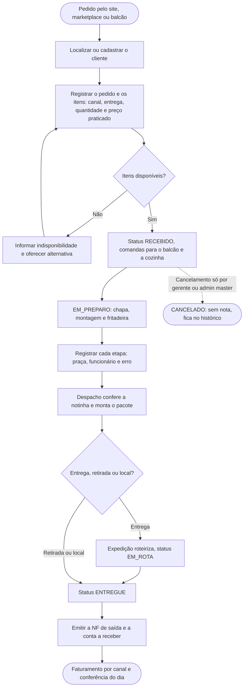
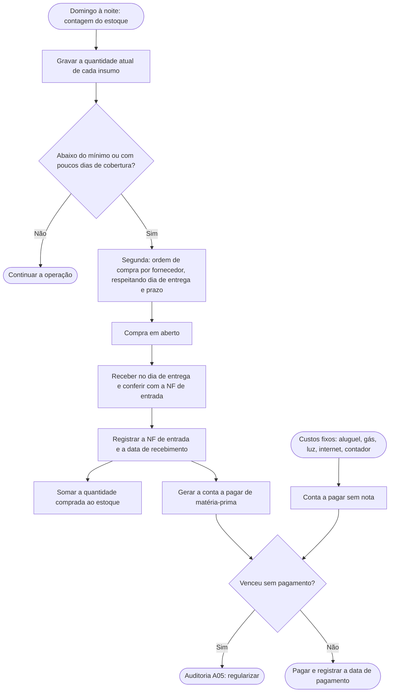
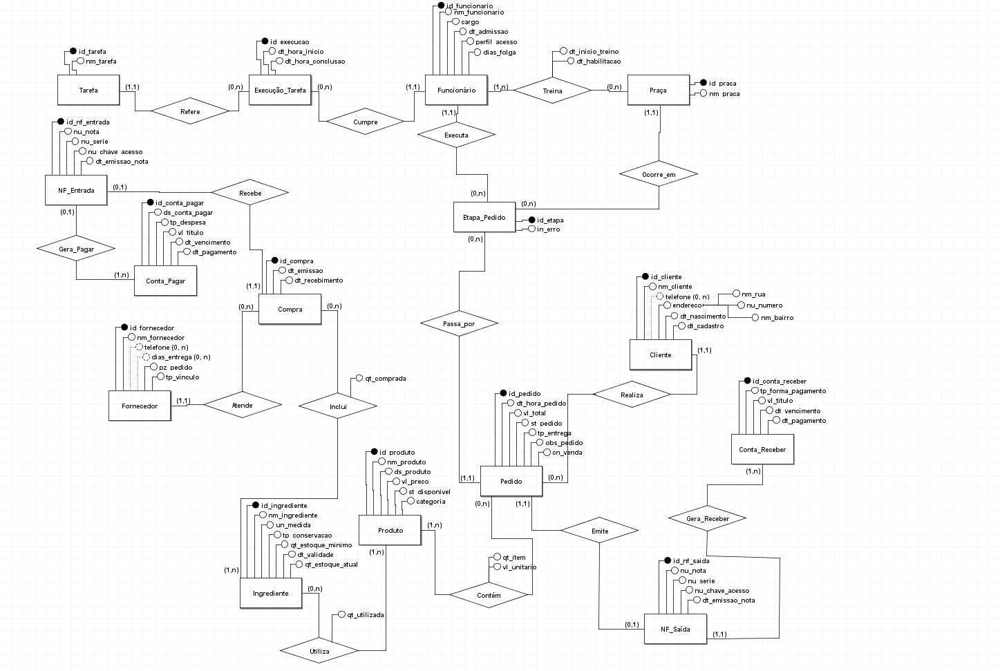
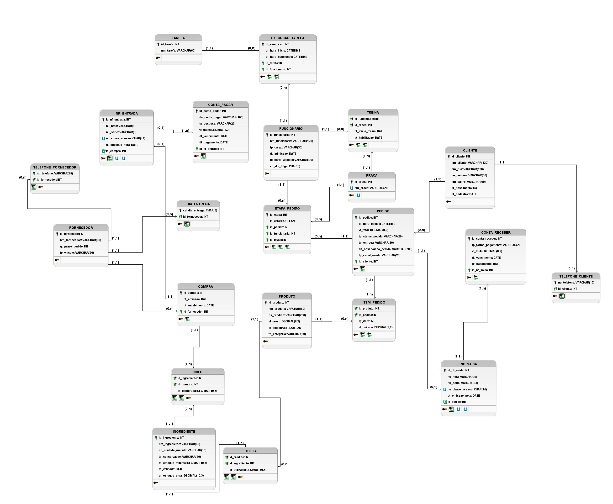

# Entrega 2 — Modelo Lógico, Implementação SQL e Apresentação Final

### Modelagem de um sistema de gestão de informações para uma organização de pequeno porte

**Projeto:** banco de dados da hamburgueria **Vaca na Faca** · Modelagem de Banco de Dados · Prof. Cid R. Andrade · UNICID · 2026

**Arquivos principais:** [DER conceitual](DER.png) · [Modelo lógico](modelo-logico.png) · [Dicionário de dados](dicionário-de-dados.html) · [Script SQL](docs/script.sql) · [Levantamento](levantamento/levantamento.md)

---

## 1. Relatório Técnico Final

### Integrantes

| Nome completo do aluno | RGM | Usuário do GitHub |
| :---- | :---- | :---- |
| Italo Augusto Gomes Azarias | 48262668 | [italogomes201107-sketch](https://github.com/italogomes201107-sketch) |
| Marcos Vinícius Oliveira de Almeida | 47866381 | [MarcosVinicius714](https://github.com/MarcosVinicius714) |
| Matheus Camargos Xavier da Costa | 47996544 | [Lazzynh](https://github.com/Lazzynh) |
| Murilo Silva de Jesus | 47940921 | [MurilouSilva](https://github.com/MurilouSilva) |
| Vinícius Ferreira Shinohara | 48101290 | [Vinishino](https://github.com/Vinishino) |

&nbsp;

### 1.1 Revisão do Modelo Conceitual

#### Caracterização da organização

- **Nome e natureza da organização:** Vaca na Faca (também chamada de "Vaca's"), hamburgueria artesanal com delivery, empresa privada com fins lucrativos, na Vila Curuçá, zona leste de São Paulo. O dono é o Henrique Alves Magalhães Venancio, que administra a loja com um sócio.
- **Contexto e porte:**
  - em funcionamento desde **2019**;
  - **10 a 14 pessoas** na operação: cozinha, balcão, despacho, expedição e motoboys. A cozinha tem **4 praças**: chapa, montagem, fritadeira e despacho;
  - cerca de **100 pedidos por dia** (cerca de 3.000 por mês), vendidos por **3 canais**:
    - o **site próprio**, que é o canal principal. O site oferece pagamento por Pix online, e nesse caso a TUNA Pagamentos só libera o pedido depois do pagamento confirmado;
    - os marketplaces **iFood, 99Food e Keeta**;
    - **presencialmente**, no balcão;
  - o **WhatsApp não fecha venda**: só capta o cliente e o leva para o site;
  - **5 a 10 fornecedores por semana**, cada um com dias fixos de entrega (por exemplo, proteína, bacon e batata chegam toda quinta);
  - cardápio em **4 categorias**: hambúrgueres, combos (o lanche com batata e bebida, e os combos Casal e Família, com vários hambúrgueres), aperitivos e bebidas. Cada lanche segue uma ficha técnica: o lanche Vaca na Faca leva pão brioche, carne de 180 g, 30 g de queijo prato, alface, tomate, cebola e maionese;
  - equipe em regime **6x1**, com 8 horas por dia e uma folga semanal.

  Esses números justificam o volume da massa de dados (seção 4).
- **Problemas e necessidades identificados:** todos são de gestão de informação, e todos aparecem no DER e têm consulta gerencial no script (ver a rastreabilidade na seção 1.6).

| Código | Problema | De onde vem (bloco do levantamento) | Como o modelo resolve | Consulta |
| :---- | :---- | :---- | :---- | :---- |
| P1 | Quando um pedido sai errado, não dá para saber quem foi o responsável nem em qual praça o erro aconteceu. | Bloco 05 da entrevista: "Hoje não". A loja quer um painel KDS "pra identificação do montador e também de quem despacha esse pedido". | ETAPA_PEDIDO registra cada praça que trabalhou no pedido, quem fez e se saiu com erro (`in_erro`). PRACA guarda as 4 praças. | G01 |
| P2 | As tarefas do "quadro de missões do dia" não são medidas: não se sabe quanto tempo cada uma leva nem se foi concluída. | Bloco 05: o Henrique chama de "nossa maior dor de cabeça". | TAREFA guarda as tarefas do quadro, e EXECUCAO_TAREFA guarda cada execução, com quem fez, o início e a conclusão. | G02 |
| P3 | Não há acompanhamento da curva de aprendizado. A loja quer cada pessoa apta em todas as praças, e a chapa pode levar mais de um mês. | Bloco 05. | TREINA guarda, para cada pessoa e cada praça, a data de início do treino e a data de habilitação. | G03 e G03b |
| P4 | O estoque é contado à mão, numa prancheta, no domingo à noite. A contagem não fica registrada, e a ordem de compra de segunda sai dessa folha. | Blocos 02 e 03. | INGREDIENTE guarda o estoque atual e o mínimo, e o consumo sai da ficha técnica (UTILIZA) e das vendas (ITEM_PEDIDO). COMPRA e INCLUI registram as ordens. | G04 |

&nbsp;

- **Escopo do sistema:** o banco reúne **todos os dados da operação**, e não só os dos problemas:
  - clientes e pedidos dos 3 canais;
  - cardápio e ficha técnica;
  - produção por praça;
  - estoque, fornecedores e compras;
  - notas fiscais de entrada e de saída;
  - contas a pagar e a receber;
  - equipe, treino e quadro de tarefas.

  Hoje a loja usa um sistema de vendas de terceiros. O projeto não depende dele: é um banco próprio, que junta esses dados num só lugar. Os itens que ficaram de fora estão justificados na lista de "processos prováveis não incluídos", mais abaixo: controle por lote, motoboy como entidade própria e detalhe da escala mensal.
- **Justificativa da escolha:** o grupo tem acesso direto ao dono e à loja. É uma operação real, com problemas de gestão de informação (responsável pelo erro, medição de tarefas, treino e estoque) e volume suficiente para um banco de 22 tabelas. **Vínculo familiar:** o integrante Vinícius Ferreira Shinohara é primo do Henrique. A entrevista foi feita na própria loja (ver o relato abaixo).
- **Evidências da organização:**
  - endereço: Rua Pedro Meira, 560, Vila Curuçá, São Paulo (SP), CEP 08030-500;
  - Google Meu Negócio: [perfil da Vaca na Faca no Google Maps](https://maps.app.goo.gl/mLRyMLnJ3tLN41FY7);
  - Instagram: [@vacanafacaburguerhouse](https://www.instagram.com/vacanafacaburguerhouse/). A loja também está no Facebook e no TikTok (bloco 06);
  - foto da visita, na cozinha da loja, com o Henrique (arquivo [`imagem hamburgueria.jpeg`](imagem%20hamburgueria.jpeg), no repositório):


- **Responsável pela organização:** Henrique Alves Magalhães Venancio, dono e sócio-administrador. Telefone: (11) 98504-9394.
#### Relato da entrevista

- **Quem:** o entrevistado foi o Henrique, dono da loja. Do grupo, participaram **Vinícius Ferreira Shinohara** e **Marcos Vinícius Oliveira de Almeida**.
- **Quando e onde:** em **02/09/2026**, na própria loja, na Rua Pedro Meira, 560. A conversa foi gravada em áudio, em 6 blocos de perguntas (das 14h01 às 14h14), e depois transcrita.
- **Comprovação:** a foto acima, tirada na cozinha durante a visita.
- **Como a entrevista é citada:** a gravação e a transcrição ficam com o grupo e não vão para o repositório, porque o esqueleto pede um texto organizado pelo grupo, e não a transcrição crua. Neste README, "bloco 01" a "bloco 06" são as seis partes da entrevista, resumidas no [levantamento](levantamento/levantamento.md), que traz as falas citadas aqui.
- **Achados pela observação no local:**
  - o Henrique mostrou ao grupo o que o sistema da loja guarda de cada cliente: o que já comprou, os pedidos mais frequentes, o aniversário e quanto gastou no mês (bloco 02: "o que você tinha mostrado aqui");
  - a cozinha onde ficam as praças, onde a foto foi tirada;
  - as comandas impressas e o suporte de comandas.
- **Achados pelas respostas do entrevistado:**

| Bloco | O que foi perguntado | O que foi levantado |
| :---- | :---- | :---- |
| 01 | Desde quando a loja funciona, quantas pessoas trabalham, por onde vende mais e quantos pedidos faz por dia. | Desde 2019, 10 a 14 pessoas, cerca de 100 pedidos por dia. Vende mais "pelo nosso site direto", além de iFood, Keeta e 99. O WhatsApp só capta e redireciona para o site. |
| 02 | Que sistema usa para os pedidos, o que ele guarda do cliente, o que mais ele faz e o que falta nele. | O sistema guarda nome, telefone, aniversário e histórico do cliente. O checklist de estoque é feito no domingo à noite, "na pranchetinha", e dele sai a ordem de compra semanal. |
| 03 | Como controla o estoque, quais insumos são mais críticos, como compra dos fornecedores, se já faltou insumo, se já perdeu comida e quanto gasta. | Há estoque mínimo por insumo (exemplo: o queijo, com uso de 40 kg por semana, pede compra em 10 a 15 kg). Cada fornecedor tem prazo e dias de entrega, e as compras são feitas às segundas. Os congelados ficam no máximo 2 semanas, por falta de espaço. Já faltou insumo e foi preciso tirar lanche do cardápio, e já se perdeu mostarda por usar antes a de validade mais longa. Boletos de insumo e custos fixos (aluguel, gás, luz, internet, advogado, nutricionista, contador, marketing) são cadastrados. |
| 04 | Como é o cardápio, se o pedido pode ser personalizado, se cada lanche tem um padrão, como é o fluxo do pedido até a entrega, como recebe o pagamento e se faz promoções. | Categorias do cardápio e personalização (adicionais, retirar ingrediente). Ficha técnica de cada lanche. Fluxo da comanda: chapa, montagem e fritadeira em paralelo, depois despacho, que confere a notinha e monta o pacote, e expedição, que roteiriza e entrega ao motoboy. Pagamento: repasse do marketplace, Pix online no site (TUNA) e maquininha, com conferência no fim do dia. Promoções subsidiadas pela loja, pela plataforma ou pelas duas. |
| 05 | Como é a escala, se dá para saber quem errou um pedido, o que só o dono ou o gerente pode fazer, o que mais dá trabalho e o que ele resolveria primeiro. | Escala 6x1, feita no 1º dia do mês e fixada no quadro de avisos. Hoje não se sabe quem errou o pedido. Cancelar, estornar e alterar itens é só para dono e gerente, e o fiscal e a conta bancária só para o administrador master. Dores: o quadro de missões sem medição e a curva de aprendizado nas praças. Erros aparecem na correria, e o erro de uma praça compromete o pedido inteiro. |
| 06 | Onde a loja está na internet e se o grupo podia tirar fotos. | A loja está no Instagram, Facebook, TikTok e Google Meu Negócio, e autorizou as fotos. |

&nbsp;

- **O que mudou em relação à Entrega 1:** não houve nova visita. Ao reler as transcrições, entraram no modelo:
  - o quadro de missões (P2) e o treino por praça (P3);
  - as formas de pagamento e o repasse dos marketplaces;
  - os boletos e os custos fixos;
  - as notas fiscais, que já eram obrigação legal.

  Ficam para confirmar com o Henrique: o critério para considerar alguém apto numa praça, a área e a taxa de entrega, e se ele aceita pagamento dividido.
- **Levantamento completo:** [levantamento/levantamento.md](levantamento/levantamento.md).

#### Processos de negócio

Os processos abaixo descrevem a operação real, com os dados que cada etapa usa. Os nomes entre crases são as colunas do modelo lógico. Quando uma etapa é uma **melhoria proposta**, e não uma rotina de hoje, isso está indicado.

**PN01. Cadastro de clientes**
- **Entrada:** cliente novo ou que volta, por qualquer canal.
- **Responsáveis:** o balcão, no pedido presencial. No site e nos marketplaces, o próprio cliente informa os dados.
- **Etapas:**
  1. procurar o cliente pelo telefone;
  2. se não existir, registrar `nm_cliente`, um ou mais `nu_telefone`, o endereço de entrega (`nm_rua`, `nu_numero`, `nm_bairro`) e `dt_cadastro`. A `dt_nascimento` só entra com o consentimento do cliente;
  3. ligar o cadastro ao pedido.
- **Saída:** CLIENTE e TELEFONE_CLIENTE.
- **Integração:** alimenta o PN02. O cliente pode ficar sem pedido, quando o cadastro é feito e a venda não é confirmada.

**PN02. Recebimento do pedido por canal**
- **Entrada:** um pedido de um destes canais:
  - do site, onde o cliente pode pagar por Pix online (nesse caso, a TUNA só libera o pedido depois do pagamento confirmado);
  - de um marketplace (iFood, 99Food ou Keeta);
  - do balcão.
- **Responsáveis:** o balcão e as plataformas de venda.
- **Etapas:**
  1. registrar o pedido com `dt_hora_pedido`, o cliente (`id_cliente`), `tp_canal_venda` (SITE, MARKETPLACE ou PRESENCIAL), `tp_entrega` (DELIVERY, RETIRADA ou LOCAL) e `ds_observacao_pedido` (adicionais ou ingrediente retirado);
  2. registrar cada item com o produto, `qt_item` e o `vl_unitario` praticado, com promoção quando houver;
  3. gravar `vl_total` como a soma dos itens (RN01);
  4. marcar `tp_status_pedido` = RECEBIDO;
  5. imprimir duas comandas, uma para o balcão e outra para a cozinha.
- **Saída:** PEDIDO e ITEM_PEDIDO.
- **Integração:** usa o PN01 e o cardápio (PN03), e dispara a produção (PN04).

**PN03. Cardápio, preços, promoções e ficha técnica**
- **Entrada:** um produto novo, uma mudança de preço ou de receita, uma promoção ou a falta de um insumo.
- **Responsáveis:** o gerente e o administrador master.
- **Etapas:**
  1. cadastrar o produto com `nm_produto`, `ds_produto`, `vl_preco`, `tp_categoria` (HAMBURGUER, COMBO, APERITIVO ou BEBIDA) e `in_disponivel`;
  2. cadastrar a ficha técnica: cada insumo do produto com a `qt_utilizada` em uma unidade (UTILIZA);
  3. nas promoções, o preço cheio fica em `vl_preco`, e o preço com desconto vai para o `vl_unitario` do item vendido. O desconto pode ser da loja, da plataforma ou dos dois;
  4. quando falta um insumo, marcar `in_disponivel` = FALSE nos produtos que o usam, encontrados pela UTILIZA (RN16).
- **Saída:** PRODUTO e UTILIZA.
- **Integração:** dá os preços para o PN02, a montagem para o PN04 e o consumo para o PN08.

**PN04. Produção na cozinha por praças**
- **Entrada:** a comanda da cozinha.
- **Responsáveis:** as pessoas de cada praça (chapa, montagem, fritadeira e despacho). Uma praça pode ter mais de uma pessoa.
- **Etapas:**
  1. o pedido passa para `tp_status_pedido` = EM_PREPARO;
  2. a chapa prepara a proteína. Ao mesmo tempo, a montagem separa o pão do lanche, e a fritadeira faz os aperitivos;
  3. a montagem finaliza o lanche conforme a ficha técnica, embala, coloca na caixa, identifica e manda para o despacho;
  4. **melhoria proposta (P1):** cada praça que trabalhou no pedido gera uma linha em ETAPA_PEDIDO, com `id_pedido`, `id_praca`, `id_funcionario` e `in_erro` = FALSE. Quando um erro é identificado, numa reclamação ou na conferência, a etapa que errou recebe `in_erro` = TRUE. Hoje esse registro não existe; a loja planeja um painel KDS para isso.
- **Saída:** os lanches prontos e as linhas de ETAPA_PEDIDO.
- **Integração:** usa a ficha técnica (PN03), passa o pedido para o PN05 e mostra quem está em treino em cada praça (PN12).

**PN05. Despacho, expedição e entrega**
- **Entrada:** o lanche embalado pela montagem e os aperitivos da fritadeira.
- **Responsáveis:** o despacho (uma das praças), a expedição e os motoboys. No modelo, os motoboys são funcionários (`tp_cargo` = MOTOBOY), porque a pergunta sobre o número de pessoas da loja incluía os entregadores (bloco 01).
- **Etapas:**
  1. o despacho junta o lanche e os aperitivos, confere a notinha item por item e monta o pacote. Essa etapa também é registrada em ETAPA_PEDIDO, na praça DESPACHO;
  2. a expedição faz a rota e entrega o pacote ao motoboy, e o pedido passa para EM_ROTA;
  3. quando o cliente recebe, o pedido passa para ENTREGUE. A retirada e o consumo no local também terminam em ENTREGUE.
- **Saída:** o pedido entregue.
- **Integração:** dispara o faturamento (PN06).

**PN06. Pagamento, repasse, faturamento e conferência do dia**
- **Entrada:** o pedido entregue.
- **Responsáveis:** o administrador master (parte fiscal e faturamento) e o gerente (conferência).
- **Etapas:**
  1. emitir a nota fiscal de saída do pedido entregue, com `nu_nota`, `nu_serie`, `nu_chave_acesso` (44 dígitos) e `dt_emissao_nota` (RN02);
  2. registrar a conta a receber com `tp_forma_pagamento` (REPASSE_MARKETPLACE, PIX_ONLINE ou MAQUININHA), `vl_titulo` e `dt_vencimento`. No marketplace, o grupo considerou como premissa que o valor vem descontado da comissão e que o vencimento é a data do repasse (a taxa e o prazo reais não foram informados). A `dt_pagamento` é preenchida quando o dinheiro cai;
  3. no fim do dia, conferir os pagamentos feitos na entrega: o motoboy tem um sistema que mostra o valor a cobrar, e o cliente escolhe a forma de pagamento;
  4. acompanhar o faturamento por canal (G05).
- **Saída:** NF_SAIDA e CONTA_RECEBER.
- **Integração:** vem do PN05 e alimenta o faturamento por canal e o fluxo de caixa.

**PN07. Cancelamento e estorno**
- **Entrada:** o pedido de cancelamento, do cliente, da plataforma ou da própria loja (por exemplo, por falta de insumo).
- **Responsáveis:** só o gerente ou o administrador master (RN14).
- **Etapas:**
  1. o pedido passa para `tp_status_pedido` = CANCELADO;
  2. o pedido cancelado não gera nota nem conta a receber (RN02). Se já tinha sido pago, é feito o estorno;
  3. o pedido continua no histórico e não é apagado (RN13).

  A reclamação por pedido errado vira erro na etapa (PN04).
- **Saída:** o pedido cancelado, registrado.
- **Integração:** pode acontecer em qualquer ponto do PN02 ao PN05 e impede o faturamento (PN06).

**PN08. Controle de estoque (checklist de domingo)**
- **Entrada:** os insumos no estoque, no domingo à noite.
- **Responsáveis:** a equipe da loja (a contagem é uma das tarefas do quadro) e o dono, que decide a compra.
- **Hoje:** a contagem é feita à mão, numa prancheta, no domingo à noite.
- **Proposta:**
  1. contar e gravar o `qt_estoque_atual` de cada insumo;
  2. comparar com o `qt_estoque_minimo` (RN06);
  3. conferir a `dt_validade` e usar primeiro o que vence antes (RN07);
  4. consultar quantos dias o estoque cobre (G04). O consumo sai das vendas (ITEM_PEDIDO) vezes a ficha técnica (UTILIZA). Os congelados não passam de 2 semanas (RN10);
  5. gerar a lista de reposição para o PN09.
- **Saída:** INGREDIENTE atualizado.
- **Integração:** usa o consumo das vendas (PN02) e a ficha técnica (PN03), e gera a lista de reposição para o PN09.

**PN09. Fornecedores e ordem de compra (segunda-feira)**
- **Entrada:** a lista de reposição do PN08.
- **Responsáveis:** o dono, que faz as compras de segunda (bloco 03), e o gerente.
- **Etapas:**
  1. cadastrar o fornecedor com `nm_fornecedor`, um ou mais `nu_telefone`, os dias em que entrega (`cd_dia_entrega`), a antecedência do pedido em dias (`qt_prazo_pedido`) e `tp_vinculo` (FIXO ou EVENTUAL);
  2. na segunda, emitir uma ordem por fornecedor: COMPRA com `id_fornecedor` e `dt_emissao`, e, para cada insumo, a `qt_comprada` (INCLUI). A ordem respeita o dia de entrega e o prazo (RN09);
  3. a ordem fica em aberto, com `dt_recebimento` vazia.
- **Saída:** COMPRA e INCLUI.
- **Integração:** vem do PN08 e leva ao recebimento (PN10).

**PN10. Recebimento e conferência da mercadoria**
- **Entrada:** a mercadoria e a nota fiscal do fornecedor, no dia de entrega.
- **Responsáveis:** quem está na loja no horário da entrega (receber mercadoria é uma das tarefas do quadro).
- **Etapas:**
  1. receber a mercadoria no dia de entrega do fornecedor;
  2. conferir a mercadoria contra a nota fiscal de entrada;
  3. registrar a NF_ENTRADA (`nu_nota`, `nu_serie`, `nu_chave_acesso`, `dt_emissao_nota`) e a `dt_recebimento` da compra (RN03);
  4. somar a `qt_comprada` ao `qt_estoque_atual`. É o UPDATE do passo 6 do script.
- **Saída:** a compra recebida e o estoque atualizado.
- **Integração:** volta ao PN08 e gera a conta a pagar (PN11).

**PN11. Contas a pagar**
- **Entrada:** o boleto do insumo (do PN10) ou a conta de um custo fixo.
- **Responsáveis:** o administrador master, que cuida da conta bancária (RN15).
- **Etapas:**
  1. cadastrar o boleto de insumo como `tp_despesa` = MATERIA_PRIMA, ligado à nota de entrada. Uma nota pode virar mais de um boleto (parcelas);
  2. cadastrar os custos fixos (aluguel, gás, luz, internet, advogado, nutricionista, contador e marketing) como CUSTO_FIXO, sem nota de entrada (RN22);
  3. preencher `ds_conta_pagar`, `vl_titulo` e `dt_vencimento`, e a `dt_pagamento` quando a conta for paga;
  4. consultar as contas vencidas e não pagas (A05).
- **Saída:** CONTA_PAGAR.
- **Integração:** vem do PN10 e entra na auditoria de contas vencidas (A05).

**PN12. Equipe: cadastro, escala e treino por praça**
- **Entrada:** uma contratação, o início do mês (escala) ou o início do treino numa praça.
- **Responsáveis:** o gerente e o administrador master (perfil de acesso).
- **Etapas:**
  1. cadastrar o funcionário com `nm_funcionario`, `tp_cargo`, `dt_admissao`, `tp_perfil_acesso` (ADMIN_MASTER, GERENTE ou COLABORADOR) e `cd_dia_folga`;
  2. a escala do mês é montada no dia 1 e fixada no quadro de avisos. A folga semanal do 6x1 fica em `cd_dia_folga`;
  3. **melhoria proposta (P3):** quando a pessoa começa numa praça, entra uma linha em TREINA com `dt_inicio_treino`. Quando o gerente a considera apta, preenche a `dt_habilitacao` (RN19). O treino é registrado praça por praça;
  4. consultar a curva de aprendizado (G03) e quem ainda está em treino (G03b).
- **Saída:** FUNCIONARIO e TREINA.
- **Integração:** define quem trabalha em cada praça no PN04 e no PN05.

**PN13. Quadro de tarefas (melhoria proposta, P2)**
- **Entrada:** o quadro de missões do dia.
- **Responsáveis:** a equipe, que executa as tarefas, e o líder do turno, que lança os registros.
- **Hoje:** existe o quadro de missões do dia, que a equipe cumpre na ordem em que está escrito. Nada é medido.
- **Proposta:**
  1. cadastrar as tarefas do quadro (`nm_tarefa`);
  2. quem pega a tarefa anota no quadro a hora de início e a hora de fim;
  3. o líder lança no fim do turno uma linha em EXECUCAO_TAREFA, com `id_tarefa`, `id_funcionario`, `dt_hora_inicio` e `dt_hora_conclusao`. Se a tarefa não foi concluída, a conclusão fica vazia (RN20);
  4. consultar o tempo médio e a porcentagem de tarefas concluídas (G02).
- **Saída:** TAREFA e EXECUCAO_TAREFA.
- **Integração:** usa o cadastro da equipe (PN12). Tarefas como a contagem de estoque e o recebimento de mercadoria ligam o quadro ao PN08 e ao PN10.

**Fluxograma 1: venda, produção, entrega e faturamento**



**Fluxograma 2: estoque, compras, recebimento e contas a pagar**



**Integração geral:** a venda depende do cliente e do cardápio. A produção depende da ficha técnica, do estoque e de quem está habilitado em cada praça. A entrega gera o faturamento. O consumo das vendas, a ficha técnica e a contagem de domingo levam à ordem de compra, e a compra recebida volta para o estoque e vira conta a pagar. A equipe sustenta a produção, e o registro das etapas, do treino e das tarefas mede essa equipe.

**Processos prováveis não incluídos:**

| Processo típico de hamburgueria | Situação | Por quê |
| :---- | :---- | :---- |
| Entrega com o motoboy como entidade própria (rota, taxa, tempo de entrega) | Não incluído | O motoboy é funcionário (`tp_cargo` = MOTOBOY), e a entrega aparece no status do pedido (EM_ROTA e ENTREGUE). Nenhum dos problemas P1 a P4 depende da rota, e quem roteiriza é a expedição. |
| Controle por lote de insumo | Não incluído | A validade é uma data por insumo, a do que vence primeiro. O lote exigiria uma tabela nova e ficou fora do escopo desta entrega (ver a 1.4). |
| Cadastro de promoções | Não incluído | O preço praticado fica em `vl_unitario`. Quem pagou o desconto (loja, plataforma ou os dois) não é necessário para nenhum problema declarado. |
| Escala mensal detalhada e controle de ponto | Parcial | Só a folga semanal (`cd_dia_folga`) entra no banco. A escala do mês é feita no quadro de avisos. |
| Folha de pagamento por funcionário | Não incluído | O total entra como custo fixo em CONTA_PAGAR. Dados trabalhistas ficam fora do escopo. |
| Reclamação e avaliação do cliente | Parcial | O erro vira `in_erro` na etapa que errou. A avaliação feita nas plataformas fica fora. |
| Divergência na conferência da mercadoria | Parcial | A conferência é feita contra a nota de entrada. A divergência item a item não é guardada. |
| Relatórios de acesso ao site (visitas, carrinho abandonado) | Não incluído | São dados da plataforma do site, e não da operação da loja. |

&nbsp;

#### Requisitos

**Requisitos funcionais**

| Código | Requisito | Processo | Atende |
| :---- | :---- | :---- | :---- |
| RF01 | O sistema deve permitir cadastrar cliente com nome (`nm_cliente`), um ou mais telefones (`nu_telefone`), endereço de entrega (`nm_rua`, `nu_numero`, `nm_bairro`), data de cadastro (`dt_cadastro`) e, com consentimento, data de nascimento (`dt_nascimento`). | PN01 | |
| RF02 | O sistema deve permitir consultar o histórico de pedidos de um cliente, com data e hora, canal, situação e valor. | PN01 | |
| RF03 | O sistema deve permitir cadastrar produto com nome, descrição, preço de venda (`vl_preco`), categoria (HAMBURGUER, COMBO, APERITIVO ou BEBIDA) e disponibilidade (`in_disponivel`). | PN03 | |
| RF04 | O sistema deve permitir registrar a ficha técnica de cada produto: os insumos e a quantidade de cada um (`qt_utilizada`) em uma unidade do produto. | PN03 | RN08 |
| RF05 | O sistema deve permitir listar os produtos que usam um insumo e marcá-los como indisponíveis quando o insumo faltar. | PN03 | RN16 |
| RF06 | O sistema deve permitir registrar pedido com data e hora, cliente, canal (SITE, MARKETPLACE ou PRESENCIAL), tipo de entrega (DELIVERY, RETIRADA ou LOCAL), observação e situação, e, para cada item, o produto, a quantidade (`qt_item`) e o preço praticado (`vl_unitario`). | PN02 | RN01 |
| RF07 | O sistema deve permitir atualizar a situação do pedido (RECEBIDO, EM_PREPARO, EM_ROTA, ENTREGUE ou CANCELADO). O cancelamento só é permitido ao gerente ou ao administrador master. | PN04 a PN07 | RN13, RN14 |
| RF08 | O sistema deve permitir registrar cada etapa de produção do pedido: a praça, o funcionário que a executou e se houve erro (`in_erro`). | PN04, PN05 | P1 |
| RF09 | O sistema deve permitir consultar a taxa de erro por praça e por funcionário. | PN04 | P1 (G01) |
| RF10 | O sistema deve permitir cadastrar as tarefas do quadro e registrar cada execução, com tarefa, funcionário, início (`dt_hora_inicio`) e conclusão (`dt_hora_conclusao`). | PN13 | P2 |
| RF11 | O sistema deve permitir consultar o tempo médio e a porcentagem de conclusão de cada tarefa. | PN13 | P2 (G02) |
| RF12 | O sistema deve permitir registrar o treino de cada funcionário em cada praça, com a data de início (`dt_inicio_treino`) e a data de habilitação (`dt_habilitacao`). | PN12 | P3 |
| RF13 | O sistema deve permitir consultar a média de dias até a habilitação por praça e quem ainda está em treino. | PN12 | P3 (G03, G03b) |
| RF14 | O sistema deve permitir cadastrar insumo com nome, unidade de medida (`cd_unidade_medida`), tipo de conservação (AMBIENTE, REFRIGERADO ou CONGELADO), estoque mínimo, estoque atual e validade. | PN08 | |
| RF15 | O sistema deve permitir registrar a contagem do estoque (`qt_estoque_atual`) e consultar quantos dias o estoque de cada insumo cobre. | PN08 | P4 (G04) |
| RF16 | O sistema deve permitir cadastrar fornecedor com nome, um ou mais telefones, dias de entrega, prazo de pedido em dias (`qt_prazo_pedido`) e vínculo (FIXO ou EVENTUAL). | PN09 | RN09 |
| RF17 | O sistema deve permitir emitir ordem de compra para um fornecedor, com data de emissão e, para cada insumo, a quantidade comprada (`qt_comprada`). | PN09 | RN06 |
| RF18 | O sistema deve permitir registrar o recebimento da compra (`dt_recebimento`), com a nota fiscal de entrada (número, série, chave de acesso e data de emissão), e somar a quantidade recebida ao estoque. | PN10 | RN03 |
| RF19 | O sistema deve permitir registrar a nota fiscal de saída do pedido entregue e as contas a receber, com forma de pagamento, valor, vencimento e data de pagamento. | PN06 | RN02 |
| RF20 | O sistema deve permitir registrar contas a pagar com descrição, tipo de despesa (MATERIA_PRIMA ou CUSTO_FIXO), valor, vencimento, data de pagamento e, quando for insumo, a nota de entrada. | PN11 | RN22 |
| RF21 | O sistema deve permitir cadastrar funcionário com nome, cargo, data de admissão, perfil de acesso e dia de folga. | PN12 | RN14, RN15, RN21 |
| RF22 | O sistema deve permitir consultar o faturamento, o ticket médio e o valor retido pela plataforma, por canal de venda. | PN06 | KPI (G05) |
| RF23 | O sistema deve permitir rodar as consultas de auditoria das regras RN01 a RN05. | todos | A01 a A05 |

&nbsp;

**Requisitos não funcionais**

| Código | Requisito | Como verificar |
| :---- | :---- | :---- |
| RNF01 | **Desempenho:** suportar o volume real, de cerca de 100 pedidos por dia (cerca de 3.000 por mês), com as consultas gerenciais respondendo em menos de 1 segundo. | Na massa de teste (102 pedidos), G01 a G05 rodaram entre 0,00 e 0,01 s (execução de 01/11/2026). Um teste com o volume de um mês ainda não foi feito. |
| RNF02 | **Integridade:** o banco deve rodar em MySQL 8.0 com InnoDB, com PK, FK, NOT NULL, UNIQUE e CHECK declarados, e o script deve rodar do zero sem erro. | Teste com o banco vazio em 01/11/2026 (seção 3). |
| RNF03 | **Segurança (controle de acesso):** 3 perfis (ADMIN_MASTER, GERENTE e COLABORADOR), com permissões por operação conforme a matriz do dicionário de dados (§6). | `tp_perfil_acesso` com CHECK. As permissões são aplicadas por GRANT ou pela aplicação. |
| RNF04 | **Privacidade (LGPD):** só CLIENTE (com TELEFONE_CLIENTE) e FUNCIONARIO têm dado pessoal, e nenhuma tabela tem dado sensível. O cadastro de cliente com histórico é anonimizado ao fim da retenção, e não apagado. | Dicionário de dados, §6. |
| RNF05 | **Rastreabilidade:** o log do SGBD (`audit_log` ou, na falta dele, `general_log`) registra quem leu e quem alterou pedidos e estoque. | É configuração do servidor MySQL, e não do script. Está descrita no dicionário de dados, §5. |
| RNF06 | **Compatibilidade de texto:** banco em `utf8mb4` com `utf8mb4_0900_ai_ci`, para guardar acentos de nomes e endereços. | `CREATE DATABASE` do script. |

&nbsp;

Mudanças em relação à Entrega 1: o antigo RNF1 ("apenas administradores podem cancelar pedidos") é uma regra de negócio e virou a RN14. O antigo RNF2 ("interface simples") não era verificável e saiu, porque o trabalho não inclui interface. O antigo RNF3 virou o RNF01, agora com uma forma de medir.

**Requisitos prováveis não incluídos:**

| Requisito típico | Por que ficou de fora |
| :---- | :---- |
| Integração automática com as APIs dos marketplaces e da TUNA | É integração de software, e não de banco. Os pedidos chegam e são gravados nas mesmas tabelas. |
| Painel KDS na cozinha | É tela e hardware. O banco já tem a ETAPA_PEDIDO para receber os registros do painel. |
| Roteirização das entregas | É feita pela expedição, e nenhum problema declarado depende dela. |
| Emissão da NF-e junto à Sefaz | É feita pelo emissor fiscal. O banco guarda os dados da nota emitida. |
| Programa de fidelidade e relatórios de visitas ao site | São de marketing e da plataforma do site, fora dos problemas declarados. |

&nbsp;

#### Regras de negócio

A Entrega 1 numerava as regras sem código. Agora cada regra tem um código. RN01 a RN05 são as regras conferidas pelas consultas de auditoria do script (A01 a A05). As regras da Entrega 1 viraram RN06 a RN10, RN12 e RN24 (marcadas com "E1"). Todas as restrições do script citam a sua regra (seção 1.5).

| Código | Regra (com os campos) | Tipo | Por que importa | Onde está no banco |
| :---- | :---- | :---- | :---- | :---- |
| RN01 | O valor total do pedido (`vl_total`) é a soma de `qt_item` × `vl_unitario` dos seus itens. | Operacional | O valor cobrado e faturado precisa bater com o que foi vendido, inclusive com as promoções. | A01 |
| RN02 | Só pedido ENTREGUE gera nota fiscal de saída e conta a receber, e cada pedido tem no máximo uma nota. Pedido cancelado não é faturado. | Legal (nota fiscal) | Evita faturar o que não foi entregue e garante a nota de toda venda concluída. | A02; UNIQUE em `NF_SAIDA.id_pedido` |
| RN03 | Toda compra recebida (`dt_recebimento` preenchida) tem nota fiscal de entrada, conferida no recebimento. Cada compra tem no máximo uma nota. | Operacional e legal | A conferência evita pagar pelo que não chegou, e a nota comprova o custo. | A03; UNIQUE em `NF_ENTRADA.id_compra` |
| RN04 | Todo insumo em estoque entra na ficha técnica de pelo menos um produto. | Operacional | Insumo que não compõe nenhum produto é estoque parado e fica fora do cálculo de consumo (G04). | A04; cardinalidade de Utiliza |
| RN05 | Conta a pagar vencida e sem `dt_pagamento` deve ser regularizada. A situação da conta (paga, em aberto ou atrasada) sai das datas e não é guardada. | Financeira | Atraso gera juros, e o fornecedor pode parar de entregar. | A05 |
| RN06 (E1) | Quando o `qt_estoque_atual` chega ao `qt_estoque_minimo` na contagem de domingo, o insumo entra na ordem de compra de segunda. Exemplo: o queijo, com uso de cerca de 40 kg por semana, pede compra em 10 a 15 kg. | Operacional | Evita a falta de insumo, que já obrigou a tirar lanche do cardápio, e a compra em excesso. | `qt_estoque_minimo`, `qt_estoque_atual`; G04 |
| RN07 (E1) | Primeiro que vence, primeiro que sai: usar antes o insumo de validade mais curta. | Operacional e sanitária | A loja já perdeu mostarda por usar antes o galão de validade mais longa (bloco 03). | `dt_validade` (a data do que vence primeiro) |
| RN08 (E1) | Todo lanche é montado conforme a ficha técnica, com a quantidade de cada insumo por unidade. | Operacional | Garante o padrão, o custo e o cálculo de consumo do estoque. | UTILIZA (`qt_utilizada`) |
| RN09 (E1) | Cada fornecedor tem dias fixos de entrega e um prazo de pedido em dias, e cada ordem de compra vai para um único fornecedor. Exemplo: o queijo só chega na quinta, e a ordem precisa sair até terça. | Operacional | Perder o prazo é ficar sem o insumo ou comprar de um fornecedor pior. | DIA_ENTREGA; `qt_prazo_pedido`; `COMPRA.id_fornecedor` NOT NULL |
| RN10 (E1) | Os congelados não passam de 2 semanas de estoque, por falta de espaço. | Restrição organizacional | Limita a quantidade da compra. | `tp_conservacao` = CONGELADO; G04 mostra os dias de cobertura |
| RN11 | Os canais de venda são SITE (site próprio, com opção de Pix online), MARKETPLACE (iFood, 99Food e Keeta) e PRESENCIAL (balcão). O WhatsApp só capta e não fecha venda. | Operacional | O canal define a forma de recebimento e a comissão. | CHECK `CHK_PEDIDO_CANAL` |
| RN12 (E1) | O marketplace paga por repasse. O site recebe por Pix online. O pagamento presencial, na entrega ou no balcão, é feito na maquininha. Premissa do grupo: o repasse vem descontado da comissão da plataforma, cuja taxa real não foi informada. | Restrição organizacional | A loja não controla as taxas das plataformas, e a margem muda por canal. | CHECK `CHK_RECEBER_FORMA`; `vl_titulo` é o valor líquido; G05 |
| RN13 | O pedido segue RECEBIDO, EM_PREPARO, EM_ROTA e ENTREGUE, ou termina em CANCELADO. O pedido cancelado fica no histórico e não é apagado. | Operacional | Mantém o histórico de vendas, de cancelamentos e de erros. | CHECK `CHK_PEDIDO_STATUS`; FK sem exclusão em cascata |
| RN14 | Cancelar pedido, estornar e adicionar ou remover produto de um pedido é só para GERENTE ou ADMIN_MASTER. Era o RNF1 da Entrega 1. | Operacional | Evita cancelamento indevido e fraude. | `tp_perfil_acesso` (CHECK `CHK_FUNCIONARIO_PERFIL`); permissões no SGBD |
| RN15 | A parte fiscal, os relatórios fiscais, o faturamento e a conta bancária são só para o ADMIN_MASTER (dono ou sócio). | Organizacional | São informações sensíveis do negócio. | `tp_perfil_acesso` |
| RN16 | Quando falta um insumo, os produtos que o usam saem do cardápio (`in_disponivel` = FALSE). Era o RF8 da Entrega 1. | Operacional | Evita vender o que não dá para fazer e cancelar depois. | `PRODUTO.in_disponivel`; UTILIZA |
| RN17 | Todo pedido pertence a um único cliente cadastrado. O cliente pode estar cadastrado sem nenhum pedido. | Operacional | Toda venda tem a quem entregar e a quem cobrar. | `PEDIDO.id_cliente` NOT NULL |
| RN18 | Cada praça que trabalha no pedido gera uma etapa, com quem fez e se saiu com erro. A etapa nasce sem erro, e o erro é apontado por quem o identifica. A mesma pessoa pode fazer duas praças no mesmo pedido, e uma praça pode ter duas pessoas. As praças são únicas: CHAPA, MONTAGEM, FRITADEIRA e DESPACHO. | Operacional (P1) | O erro de uma só praça já compromete o pedido inteiro (bloco 05). | ETAPA_PEDIDO; DEFAULT FALSE em `in_erro`; UNIQUE em `nm_praca`; G01 |
| RN19 | O treino é registrado por praça. A pessoa fica habilitada quando o gerente preenche a `dt_habilitacao`, que não pode ser anterior à `dt_inicio_treino`. O critério de habilitação é definido pelo responsável. | Operacional (P3) | Mede o tempo até a pessoa ficar apta em cada praça. | TREINA; CHECK `CHK_TREINA_DATAS`; G03 |
| RN20 | Cada execução de tarefa tem quem fez, o início e a conclusão, e a conclusão não pode ser anterior ao início. A tarefa não concluída fica com a conclusão vazia. | Operacional (P2) | Mede o tempo das tarefas e o que ficou por fazer. | EXECUCAO_TAREFA; CHECK `CHK_EXECUCAO_HORAS`; G02 |
| RN21 | Escala 6x1: cada funcionário tem uma folga semanal, definida na escala do mês, e trabalha 8 horas com 1 hora de intervalo. | Organizacional e legal (trabalhista) | Define quem está disponível em cada dia. | `cd_dia_folga` |
| RN22 | Toda conta a pagar é MATERIA_PRIMA (boleto de insumo) ou CUSTO_FIXO (aluguel, gás, luz, internet, contador e outros). Só a de matéria-prima pode ter nota de entrada. | Financeira | Separa o custo da mercadoria dos custos fixos. | CHECK `CHK_PAGAR_DESPESA` e `CHK_PAGAR_NF_MATERIA` |
| RN23 | Cada nota fiscal tem uma chave de acesso de 44 dígitos, que não se repete. | Legal (NF-e) | A chave identifica a nota junto ao fisco. | UNIQUE em `nu_chave_acesso` (NF_SAIDA e NF_ENTRADA) |
| RN24 (E1) | LGPD (Lei 13.709/2018): nome, telefone e endereço do cliente são tratados para executar a venda e a entrega (art. 7º, V). A data de nascimento só com consentimento (art. 7º, I), por isso é opcional. Cliente sem pedido pode ter o cadastro eliminado a pedido dele, como no DELETE do passo 7 do script. Cliente com pedidos é anonimizado, porque as vendas e as notas precisam ser mantidas. | Legal | Protege o dado pessoal sem perder o histórico fiscal. | `dt_nascimento` aceita nulo; a FK impede apagar cliente com pedido (erro 1451) |
| RN25 | Normas sanitárias: insumo vencido não pode ser usado, e cada insumo tem tipo de conservação e validade. | Legal (vigilância sanitária) | Segurança do alimento. | `tp_conservacao`; `dt_validade` |

&nbsp;

**Regras prováveis não incluídas:**

| Regra típica | Por que ficou de fora |
| :---- | :---- |
| Área e taxa de entrega | Não foram citadas na entrevista como regra da loja. Nos pedidos de marketplace, quem define é a plataforma. Fica para confirmar com o Henrique. |
| Pedido mínimo e tempo máximo de entrega | Não foram citados na entrevista. |
| Divisão do subsídio das promoções (loja, plataforma ou os dois) | O banco guarda só o preço praticado, que é o necessário para o faturamento. |
| Pagamento dividido em mais de uma forma | O modelo já permite mais de uma conta a receber por nota (1,n), mas a regra não foi confirmada com o Henrique. |

&nbsp;

#### DER conceitual revisado (Caso A, mesma organização da Entrega 1)

O DER foi feito no **brModelo** (versão 3, desktop), na notação do brModelo. Ele não tem chaves estrangeiras: elas só aparecem no modelo lógico (seção 2).



**Leitura das cardinalidades:** segue o exemplo do professor e o brModelo. O par `(mín, máx)` ao lado de uma entidade diz quantas ocorrências dela se ligam a uma ocorrência da entidade do outro lado. Exemplo: em Realiza, o (1,1) ao lado de Cliente diz que cada pedido tem exatamente um cliente, e o (0,n) ao lado de Pedido diz que cada cliente tem de zero a muitos pedidos. Na Entrega 1, o grupo lia ao contrário, e por isso várias cardinalidades estavam erradas.

**Entidades (15):** Cliente, Pedido, Produto, Ingrediente, Fornecedor, Compra, Funcionário, Praça, Etapa_Pedido, Tarefa, Execução_Tarefa, NF_Saída, NF_Entrada, Conta_Pagar e Conta_Receber.
- **Multivalorados:** `telefone` (0,n) em Cliente e em Fornecedor, e `dias_entrega` (0,n) em Fornecedor.
- **Composto:** `endereco` em Cliente, com `nm_rua`, `nu_numero` e `nm_bairro`.
- **Atributos de relacionamento:** ficam no losango: `qt_item` e `vl_unitario` (Contém), `qt_utilizada` (Utiliza), `qt_comprada` (Inclui), `dt_inicio_treino` e `dt_habilitacao` (Treina).

**Relacionamentos (15):**

| Relacionamento | Par ao lado de cada entidade | Tipo | Motivo |
| :---- | :---- | :---- | :---- |
| Realiza | Cliente (1,1) · Pedido (0,n) | 1:N | Cada pedido é de um cliente. O cadastro vem antes do pedido, e o cliente fica sem pedido quando a venda não é confirmada. |
| Contém (`qt_item`, `vl_unitario`) | Produto (1,n) · Pedido (0,n) | N:N | Todo pedido tem pelo menos um produto. Um produto novo ainda não foi vendido. |
| Utiliza (`qt_utilizada`) | Produto (1,n) · Ingrediente (0,n) | N:N | Todo insumo entra em algum produto (RN04). O mínimo 0 do lado do Ingrediente permite produto sem ficha técnica, como a bebida revendida pronta. Na massa de dados, cada bebida foi ligada à própria unidade em estoque, para entrar no cálculo de cobertura (G04). |
| Atende | Fornecedor (1,1) · Compra (0,n) | 1:N | Cada ordem de compra vai para um fornecedor. Um fornecedor novo ainda não recebeu nenhuma ordem. |
| Inclui (`qt_comprada`) | Ingrediente (1,n) · Compra (0,n) | N:N | Toda ordem tem pelo menos um insumo. Um insumo novo ainda não foi comprado. |
| Emite | Pedido (1,1) · NF_Saída (0,1) | 1:1 | Uma nota por pedido. O pedido cancelado não é faturado. |
| Recebe | Compra (1,1) · NF_Entrada (0,1) | 1:1 | A compra fica em aberto, sem nota, até a mercadoria chegar. |
| Gera_Pagar | NF_Entrada (0,1) · Conta_Pagar (1,n) | 1:N | O custo fixo não tem nota de compra. Uma nota pode virar um ou mais boletos. |
| Gera_Receber | NF_Saída (1,1) · Conta_Receber (1,n) | 1:N | Toda venda faturada gera recebimento. O máximo n deixa espaço para o pagamento dividido. |
| Passa_por | Pedido (1,1) · Etapa_Pedido (0,n) | 1:N | Cada etapa é de um pedido. Um pedido recém-recebido ainda não passou por nenhuma praça. |
| Executa | Funcionário (1,1) · Etapa_Pedido (0,n) | 1:N | Cada etapa tem um responsável. Um funcionário recém-admitido ainda não fez nenhuma. |
| Ocorre_em | Praça (1,1) · Etapa_Pedido (0,n) | 1:N | Cada etapa acontece numa praça. |
| Treina (`dt_inicio_treino`, `dt_habilitacao`) | Funcionário (1,n) · Praça (0,n) | N:N | Toda praça tem pelo menos uma pessoa. Quem não é da cozinha, como o motoboy, não treina em nenhuma praça. |
| Cumpre | Funcionário (1,1) · Execução_Tarefa (0,n) | 1:N | Cada execução é de uma pessoa. |
| Refere | Tarefa (1,1) · Execução_Tarefa (0,n) | 1:N | Cada execução é de uma tarefa do quadro. Uma tarefa nova ainda não foi executada. |

&nbsp;

**Por que Etapa_Pedido e Execução_Tarefa são entidades, e Treina é relacionamento:** na tabela associativa, o par de chaves não pode se repetir (aula `03-02`). A mesma pessoa pode fazer duas praças no mesmo pedido, e a mesma tarefa é feita várias vezes pela mesma pessoa. Por isso essas duas viraram entidades, com identificador próprio. No treino, cada pessoa tem uma só linha por praça, então Treina ficou como N:N.

**Apontamentos da correção da Entrega 1 e o que foi feito:**

| Apontamento da correção da E1 | O que mudou no trabalho | Por quê |
| :---- | :---- | :---- |
| Critério 2: o README grafava "Matheus Camargo" | Corrigido para "Matheus Camargos Xavier da Costa", e a tabela de integrantes ganhou RGM e usuário do GitHub. | O nome precisa bater com a lista de frequência e com a conta do GitHub. |
| Critério 3.1: o Instagram não foi aberto | Entraram o perfil do Google Meu Negócio, o endereço completo e o responsável com telefone. A foto continua no repositório. | O esqueleto da E2 pede a comprovação mais direta. |
| Critério 5: processos só nomeados, sem fluxo (35%). Estavam parciais: cadastro de clientes, recebimento do pedido por canal, produção por praças, cardápio e preços, cadastro de fornecedores, ordem de compra, controle de estoque e escala por praça | 13 processos descritos, cada um com entrada, responsáveis, etapas com os dados, saída e integração, mais 2 fluxogramas e a lista dos processos não incluídos. Os parciais viraram: cadastro de clientes → PN01; recebimento por canal → PN02; cardápio e preços → PN03; produção por praças → PN04; controle de estoque → PN08; fornecedores e ordem de compra → PN09; escala por praça → PN12. | Os 13 processos da tabela da correção agora estão descritos ou justificados. |
| Critério 5: despacho e entrega pelo motoboy ausentes | PN05 (despacho, expedição e entrega). O motoboy é funcionário, e a entrega aparece no status. | O fluxo veio do bloco 04 da entrevista. |
| Critério 5: pagamento e repasse dos marketplaces ausentes | PN06, com Conta_Receber (forma de pagamento, valor líquido, vencimento e pagamento). | O pagamento veio do bloco 04. A entidade Pagamento sugerida virou Conta_Receber. |
| Critério 5: cancelamento, estorno e reclamação ausentes | PN07, com o status CANCELADO, sem nota e mantido no histórico. A reclamação vira erro na etapa (PN04). | Bloco 05: só dono e gerente cancelam e estornam. |
| Critério 5: recebimento e conferência da mercadoria ausentes | PN10, com NF_Entrada, `dt_recebimento` e a entrada no estoque. | Sem isso, o estoque não volta a subir depois da compra. |
| Critério 5: fechamento de caixa e financeiro ausentes | PN06 (conferência do dia e faturamento por canal) e PN11 (contas a pagar). | O controle financeiro foi citado no bloco 03. |
| Critério 7: o RNF1 era regra de negócio | Virou a RN14. | É uma regra de quem pode fazer o quê, e não de qualidade do sistema. |
| Critério 7: o RNF2 ("interface simples") não era verificável | Saiu. Cada RNF agora tem uma forma de verificar. | O trabalho não inclui interface. |
| Critério 8: regras sem explicar por que importam (54%) | Tabela com 25 regras, cada uma com o tipo, o motivo e onde está no banco. | Atende os 14 itens da tabela da correção: as regras já cobertas viraram RN06 a RN10, e as parciais ou ausentes viraram RN02, RN03, RN12, RN14, RN16, RN19, RN21, RN23, RN24 e RN25. A área e a taxa de entrega estão justificadas como não incluídas. |
| Critério 9: no dicionário, os valores (`[TP_RECEBIDO \| ...]`) apareciam no lugar do atributo | No dicionário v1.2, a expressão traz o atributo (`TP_STATUS_PEDIDO`, `TP_CATEGORIA`, `TP_VINCULO`, `TP_PERFIL_ACESSO`), e os valores permitidos ficam na restrição de cada coluna. | É o formato do exemplo do professor (`02-03g`). |
| Critério 10: Realiza deixava um pedido ter vários clientes | Agora é Cliente (1,1) e Pedido (0,n): o (1,1) ao lado de Cliente diz que cada pedido tem exatamente um cliente. | A leitura da cardinalidade estava invertida (ver "Leitura das cardinalidades"). |
| Critério 10: Contém com (1,n) obrigava todo produto a já ter sido vendido | Na E1, os dois lados eram (1,n). O (1,n) ao lado de Pedido (cada produto em 1 a n pedidos) virou (0,n). O (1,n) ao lado de Produto continua e quer dizer que todo pedido tem pelo menos um produto. | Um produto novo pode ser cadastrado antes da primeira venda. |
| Critério 10: Contém sem quantidade por item | `qt_item` e `vl_unitario` no Contém, que no lógico virou ITEM_PEDIDO. | Sem isso, não se sabe quanto de cada produto foi vendido nem por qual preço. |
| Critério 10: Utiliza sem quantidade de cada insumo (ficha técnica) | `qt_utilizada` no Utiliza. | É a ficha técnica do bloco 04, e é o que permite calcular o consumo (G04). |
| Critério 10: não havia registro de compra | Entidade Compra, com os relacionamentos Atende e Inclui (`qt_comprada`). | A regra do estoque mínimo exige a ordem de compra. |
| Critério 10: Ingrediente sem quantidade atual em estoque | `qt_estoque_atual` em Ingrediente. | Sem ela, não dá para registrar a contagem de domingo nem comparar com o mínimo. |
| Critério 10: `dt_validade` única não acomoda lotes | A data foi mantida com uma premissa: é a validade do que vence primeiro. O lote ficou fora do escopo. | Atende a regra RN07 sem criar uma tabela nova. O professor marcou o lote como desejável, e ele está justificado na 1.4. |
| Critério 10: grafia `dt_hota_pedido` no DER | Corrigida para `dt_hora_pedido`. | Erro de digitação. |
| Entidades desejáveis: Pagamento, Entrega/Motoboy e Lote | Pagamento virou Conta_Receber. Entrega/Motoboy e Lote não entraram, com justificativa na lista de processos não incluídos. | Nenhum problema declarado depende da rota nem do lote. |
| Critério 11: a justificativa técnica cobria só uma cardinalidade, sem alternativas | Seção 1.5 nova, com as alternativas descartadas (Fornece, multivalorados como colunas, compra sem entidade, todos os relacionamentos N:N, Prepara, Conta_Receber ligada ao pedido e tabela CARGO), e a tabela de relacionamentos acima, com o motivo de cada cardinalidade. | A justificativa antiga também citava o Fornece e a Conta_Receber agrupando pedidos, que não existem mais. |
| Observação: a Seção 5 do README ficou com o texto do esqueleto | O dicionário fica só no HTML, com link na seção 5, e nenhum texto do esqueleto ficou no README. | Evita conteúdo duplicado. |
| Observação: o fluxo de dados do §2 do dicionário (visão de DFD) resolveria boa parte do critério 5, mas não estava na seção avaliada | O fluxo foi trazido para os processos de negócio do README, com os dados de cada etapa e os fluxogramas. | Os processos agora estão na seção que o professor avalia. |
| Observação: conflito de interesse (o dono é primo de um integrante) | Continua declarado, agora com o nome do integrante (Vinícius Ferreira Shinohara), na justificativa da escolha. | O esqueleto da E2 pede que o vínculo seja declarado. Ele não dispensa a entrevista no local, que foi feita. |
| Pedido do professor em aula: revisar as cardinalidades | Todas as 15 foram revisadas na leitura do brModelo e do exemplo do professor. | Ver "Leitura das cardinalidades". |
| Pedido do professor em aula: criar NF e contas a pagar e a receber | Entraram NF_Saída, NF_Entrada, Conta_Pagar e Conta_Receber, com os relacionamentos Emite, Recebe, Gera_Pagar e Gera_Receber. | Fecham o ciclo financeiro e fiscal da venda e da compra. |
| Pedido do professor em aula: tirar o Fornece | O Fornece saiu. | A Compra já liga o fornecedor ao insumo, pelo Atende e pelo Inclui. |
| Pedido do professor em aula: não usar o sistema de vendas atual (CRM) como argumento | O Realiza é justificado pelo cadastro antes da venda, o P4 foi reescrito sem o CRM, e há uma nota de escopo. | O banco proposto reúne os dados da loja sem depender de outro sistema. |
| Problemas declarados que não apareciam no DER (erro comum citado no esqueleto da E2) | Entraram Praça, Etapa_Pedido (P1), Tarefa e Execução_Tarefa (P2) e as datas no Treina (P3). Saíram o Prepara e o `pracas_aptas`. | O Prepara dizia quem mexeu no pedido, mas não a praça nem o erro. Sem tabelas, o P2 e o P3 não tinham consulta. |

&nbsp;

### 1.2 Conversão do Modelo Conceitual para o Modelo Lógico

A conversão foi feita no brModelo e depois conferida e ajustada à mão, seguindo a aula `03-01`/`03-02`.

- **Entidades → Tabelas:** cada uma das 15 entidades virou uma tabela com o mesmo nome, em maiúsculas e sem acento: CLIENTE, PEDIDO, PRODUTO, INGREDIENTE, FORNECEDOR, COMPRA, FUNCIONARIO, PRACA, ETAPA_PEDIDO, TAREFA, EXECUCAO_TAREFA, NF_SAIDA, NF_ENTRADA, CONTA_PAGAR e CONTA_RECEBER.
- **Atributos → Colunas:**
  - **atributos simples** viraram colunas, com o tipo do dicionário de dados;
  - **atributo composto:** o `endereco` virou as colunas `nm_rua`, `nu_numero` e `nm_bairro` em CLIENTE;
  - **atributos multivalorados** viraram tabelas próprias, com chave composta e FK para a dona: TELEFONE_CLIENTE, TELEFONE_FORNECEDOR e DIA_ENTREGA;
  - **nomes:** as colunas são os nomes do dicionário escritos em minúsculas. O DER manteve alguns nomes antigos de propósito, porque a seção "Prefixos" do dicionário documenta a troca:

| No DER | No modelo lógico | No DER | No modelo lógico |
| :---- | :---- | :---- | :---- |
| `st_pedido` | `tp_status_pedido` | `un_medida` | `cd_unidade_medida` |
| `cn_venda` | `tp_canal_venda` | `pz_pedido` | `qt_prazo_pedido` |
| `obs_pedido` | `ds_observacao_pedido` | `cargo` | `tp_cargo` |
| `st_disponivel` | `in_disponivel` | `perfil_acesso` | `tp_perfil_acesso` |
| `categoria` | `tp_categoria` | `dias_folga` | `cd_dia_folga` |
| `telefone` | `nu_telefone` | `dias_entrega` | `cd_dia_entrega` |

- **Relacionamentos → Chaves:**
  - **1:N:** a FK fica na tabela do lado N: `PEDIDO.id_cliente`, `COMPRA.id_fornecedor`, `CONTA_PAGAR.id_nf_entrada`, `CONTA_RECEBER.id_nf_saida`, `ETAPA_PEDIDO.id_pedido`, `.id_funcionario` e `.id_praca`, e `EXECUCAO_TAREFA.id_tarefa` e `.id_funcionario`;
  - **1:1 (Emite e Recebe):** a FK fica no lado opcional (0,1), que é a nota, e é declarada UNIQUE e NOT NULL: `NF_SAIDA.id_pedido` e `NF_ENTRADA.id_compra`;
  - **N:N:** cada um virou uma tabela associativa, com chave composta pelas duas FKs e com os atributos do relacionamento. O Contém virou ITEM_PEDIDO (`qt_item`, `vl_unitario`), o Utiliza virou UTILIZA (`qt_utilizada`), o Inclui virou INCLUI (`qt_comprada`), e o Treina virou TREINA (`dt_inicio_treino`, `dt_habilitacao`).
- **Cardinalidades:**
  - mínimo 1 do lado referenciado: FK NOT NULL (por exemplo, `PEDIDO.id_cliente`);
  - mínimo 0: FK que aceita nulo. É o caso de `CONTA_PAGAR.id_nf_entrada`, porque o custo fixo não tem nota;
  - máximo 1 no 1:1: UNIQUE na FK;
  - máximo n: a FK pode se repetir.

  No diagrama lógico, cada ligação mostra (1,1) ou (0,1) do lado da tabela referenciada e, do lado da tabela da FK, quantas linhas dela existem para uma linha da referenciada.
- **Generalização/especialização:** o DER não tem.
- **Ajustes feitos à mão depois do conversor do brModelo:**
  - o conversor pôs a FK dos multivalorados invertida, na tabela da entidade, e ela foi movida para a tabela do multivalorado;
  - as tabelas das N:N saíram sem PK, e ganharam a chave composta;
  - os nomes foram trocados pelos do dicionário;
  - 8 tipos foram corrigidos. Exemplo: `nu_nota` virou VARCHAR(9) e `nu_serie` virou VARCHAR(3), porque são números sem cálculo e são guardados como texto.
- **Tipos usados:**
  - `INT` nos identificadores;
  - `VARCHAR` nos textos;
  - `DECIMAL(8,2)` em valores em reais;
  - `DECIMAL(10,3)` em quantidades de insumo (kg, L ou unidade);
  - `DATE` e `DATETIME` em datas;
  - `BOOLEAN` em `in_disponivel` e `in_erro`;
  - `CHAR(44)` na chave de acesso;
  - `CHAR(3)` nos dias da semana (SEG, TER…).

### 1.3 Definição de Chaves Primárias e Estrangeiras

| Tabela | Chave primária | Chaves estrangeiras |
| :---- | :---- | :---- |
| CLIENTE | `id_cliente` | — |
| TELEFONE_CLIENTE | (`nu_telefone`, `id_cliente`) | `id_cliente` → CLIENTE |
| PEDIDO | `id_pedido` | `id_cliente` → CLIENTE |
| PRODUTO | `id_produto` | — |
| ITEM_PEDIDO | (`id_produto`, `id_pedido`) | `id_produto` → PRODUTO; `id_pedido` → PEDIDO |
| INGREDIENTE | `id_ingrediente` | — |
| UTILIZA | (`id_produto`, `id_ingrediente`) | `id_produto` → PRODUTO; `id_ingrediente` → INGREDIENTE |
| FORNECEDOR | `id_fornecedor` | — |
| TELEFONE_FORNECEDOR | (`id_fornecedor`, `nu_telefone`) | `id_fornecedor` → FORNECEDOR |
| DIA_ENTREGA | (`cd_dia_entrega`, `id_fornecedor`) | `id_fornecedor` → FORNECEDOR |
| COMPRA | `id_compra` | `id_fornecedor` → FORNECEDOR |
| INCLUI | (`id_compra`, `id_ingrediente`) | `id_compra` → COMPRA; `id_ingrediente` → INGREDIENTE |
| NF_ENTRADA | `id_nf_entrada` | `id_compra` → COMPRA (UNIQUE) |
| CONTA_PAGAR | `id_conta_pagar` | `id_nf_entrada` → NF_ENTRADA (aceita nulo) |
| NF_SAIDA | `id_nf_saida` | `id_pedido` → PEDIDO (UNIQUE) |
| CONTA_RECEBER | `id_conta_receber` | `id_nf_saida` → NF_SAIDA |
| FUNCIONARIO | `id_funcionario` | — |
| PRACA | `id_praca` | — |
| TREINA | (`id_funcionario`, `id_praca`) | `id_funcionario` → FUNCIONARIO; `id_praca` → PRACA |
| ETAPA_PEDIDO | `id_etapa` | `id_pedido` → PEDIDO; `id_funcionario` → FUNCIONARIO; `id_praca` → PRACA |
| TAREFA | `id_tarefa` | — |
| EXECUCAO_TAREFA | `id_execucao` | `id_tarefa` → TAREFA; `id_funcionario` → FUNCIONARIO |

&nbsp;

No total, são 22 tabelas, 22 chaves primárias (7 compostas) e 22 chaves estrangeiras, conferidas no `information_schema` depois de rodar o script.

### 1.4 Processo de Normalização (1FN, 2FN e 3FN)

**Método.** Seguimos o passo a passo da aula de normalização (`04-01`): mapear chaves e dependências funcionais (DF), aplicar 1FN, 2FN e 3FN, ligar as tabelas por chave estrangeira e conferir que a junção reconstrói o original. O ponto de partida são os registros que a loja usa hoje, citados na entrevista de 02/09/2026 (os blocos estão no [levantamento](levantamento/levantamento.md)). Cada um foi tratado como uma **relação universal**: todos os dados daquele registro numa tabela só, como no estudo de caso da locadora de DVDs da aula.

| Relação universal | De onde vem |
| :---- | :---- |
| R1. Venda | O pedido com a comanda que vai ao balcão e à cozinha e a "notinha" que o despacho confere item por item (bloco 04). Os dados do cliente: nome, telefone e aniversário, que o sistema da loja guarda (bloco 02), e o endereço de entrega (DER e dicionário §4). E quem trabalhou em cada praça da comanda (chapa, montagem, fritadeira e despacho, bloco 04): hoje não dá para saber, e a loja quer um painel KDS "pra identificação do montador e também de quem despacha esse pedido" (bloco 05). |
| R2. Ordem de compra | O checklist de estoque de domingo e a ordem de compra de segunda, feita para cada fornecedor conforme o prazo e os dias de entrega dele (blocos 02 e 03). |
| R3. Ficha técnica | A ficha de cada lanche: "pão brioche, uma carne de 180 gramas, 30 gramas de queijo prato…" (bloco 04). |
| R4. Equipe | O cadastro, a escala (regime 6x1 com uma folga semanal) e o treino: a loja quer cada pessoa em todas as praças, e cada praça leva um tempo diferente para cada pessoa (bloco 05). |
| R5. Financeiro | Os boletos de insumo e os custos fixos (bloco 03) e as formas de recebimento: repasse do marketplace, Pix pela TUNA e maquininha (bloco 04). As notas fiscais entraram na revisão do DER, a pedido do professor. |
| R6. Quadro de tarefas | O "quadro de missões do dia", que a equipe vai cumprindo "de acordo com a ordem que tá lá" (bloco 05). Hoje não se sabe quanto tempo cada tarefa leva. A proposta do grupo é cada pessoa anotar no quadro a hora de início e de fim, e o líder lançar no sistema no fim do turno. |

Nas relações abaixo, as chaves `{ }` marcam grupos repetitivos (relações aninhadas). Na 1FN, cada grupo vira uma relação separada com chave própria, como manda a aula ("criar novas relações separadas para cada atributo multivalorado ou relação aninhada"). Por isso, nas tabelas de DF, o tipo de cada dependência é dado em relação à tabela em que ela fica depois da 1FN:
- **parcial:** o determinante é só um pedaço de uma chave composta (resolvida na 2FN);
- **transitiva:** um atributo não chave determina outro (resolvida na 3FN);
- **total:** o atributo depende da chave composta inteira.

#### R1. Venda

`VENDA(id_pedido, dt_hora_pedido, vl_total, tp_status_pedido, tp_entrega, tp_canal_venda, ds_observacao_pedido, id_cliente, nm_cliente, {nu_telefone}, endereco(nm_rua, nu_numero, nm_bairro), dt_nascimento, dt_cadastro, {id_produto, nm_produto, ds_produto, vl_preco, in_disponivel, tp_categoria, qt_item, vl_unitario}, {id_etapa, in_erro, id_funcionario, nm_funcionario, id_praca, nm_praca})`

| Determinante | Determina | Tipo |
| :---- | :---- | :---- |
| id_pedido | dt_hora_pedido, vl_total, tp_status_pedido, tp_entrega, tp_canal_venda, ds_observacao_pedido, id_cliente | Depende da chave primária (tabela do pedido, chave simples) |
| id_cliente | nm_cliente, nm_rua, nu_numero, nm_bairro, dt_nascimento, dt_cadastro | Transitiva (id_pedido → id_cliente → dados do cliente) |
| id_produto | nm_produto, ds_produto, vl_preco, in_disponivel, tp_categoria | Parcial (na tabela de itens) |
| id_pedido + id_produto | qt_item, vl_unitario | Total (na tabela de itens) |
| id_etapa | in_erro, id_funcionario, id_praca | Depende da chave primária (tabela das etapas, chave simples) |
| id_funcionario | nm_funcionario | Transitiva (id_etapa → id_funcionario → nm_funcionario) |
| id_praca | nm_praca | Transitiva (id_etapa → id_praca → nm_praca) |

- **1FN.**
  - O endereço é composto. Suas partes viram as colunas `nm_rua`, `nu_numero` e `nm_bairro`, como na aula `03-01`.
  - O telefone é multivalorado e vira `TELEFONE_CLIENTE(id_cliente, nu_telefone)`, com chave composta.
  - Os itens do pedido são um grupo repetitivo e vão para uma tabela de itens com chave `(id_pedido, id_produto)`.
  - As etapas da comanda são outro grupo repetitivo: cada praça que trabalhou no pedido, quem fez e se saiu com erro. A mesma pessoa pode fazer duas praças no mesmo pedido, e a mesma praça pode ter duas pessoas, como dois chapeiros. Cada etapa tem identificador próprio, como os títulos de R5, então a chave da tabela nova é `id_etapa`, e o pedido entra como FK.
  - O resto continua numa tabela de pedido com chave `id_pedido`.
- **2FN.**
  - Na tabela de itens, `id_produto` sozinho determina os dados do produto. Eles saem para `PRODUTO(id_produto, nm_produto, ds_produto, vl_preco, in_disponivel, tp_categoria)`.
  - Fica `ITEM_PEDIDO(id_pedido, id_produto, qt_item, vl_unitario)`. O `vl_unitario` depende da chave inteira: o mesmo produto sai por preços diferentes em pedidos diferentes, por causa das promoções da loja, da plataforma ou das duas (bloco 04). O preço cheio de hoje é o `vl_preco`, que fica em PRODUTO.
  - A tabela de pedido e a das etapas têm chave simples, então já estão na 2FN (regra da aula: sem chave composta não há dependência parcial).
- **3FN.**
  - Na tabela de pedido, `id_pedido → id_cliente` e `id_cliente → nm_cliente, nm_rua, …` é o mesmo caso do `ecod → title → sal` da aula.
  - Os dados do cliente saem para `CLIENTE(id_cliente, nm_cliente, nm_rua, nu_numero, nm_bairro, dt_nascimento, dt_cadastro)`.
  - Fica `PEDIDO(id_pedido, dt_hora_pedido, vl_total, tp_status_pedido, tp_entrega, tp_canal_venda, ds_observacao_pedido, id_cliente)`, com `id_cliente` como FK.
  - Na tabela das etapas, `id_etapa → id_funcionario → nm_funcionario` e `id_etapa → id_praca → nm_praca` também são transitivas. O nome do funcionário sai para FUNCIONARIO (completada em R4), e o da praça para `PRACA(id_praca, nm_praca)`.
  - Fica `ETAPA_PEDIDO(id_etapa, in_erro, id_pedido, id_funcionario, id_praca)`, com três FKs. O `in_erro` depende só da etapa, não do pedido inteiro: "se o chapeiro errar o ponto e o resto da galera fizer tudo certo, a experiência do cliente já foi comprometida" (bloco 05). O erro é de uma etapa, e as outras do mesmo pedido podem ter saído certas.

#### R2. Ordem de compra

`ORDEM(id_compra, dt_emissao, dt_recebimento, id_fornecedor, nm_fornecedor, qt_prazo_pedido, tp_vinculo, {nu_telefone}, {cd_dia_entrega}, {id_ingrediente, nm_ingrediente, cd_unidade_medida, tp_conservacao, qt_estoque_minimo, dt_validade, qt_estoque_atual, qt_comprada})`

| Determinante | Determina | Tipo |
| :---- | :---- | :---- |
| id_compra | dt_emissao, dt_recebimento, id_fornecedor | Depende da chave primária (tabela da ordem, chave simples) |
| id_fornecedor | nm_fornecedor, qt_prazo_pedido, tp_vinculo | Transitiva (id_compra → id_fornecedor → dados do fornecedor) |
| id_ingrediente | nm_ingrediente, cd_unidade_medida, tp_conservacao, qt_estoque_minimo, dt_validade, qt_estoque_atual | Parcial (na tabela de itens da ordem) |
| id_compra + id_ingrediente | qt_comprada | Total (na tabela de itens da ordem) |

- **1FN.**
  - O telefone do fornecedor vira `TELEFONE_FORNECEDOR(id_fornecedor, nu_telefone)`.
  - Os dias de entrega viram `DIA_ENTREGA(id_fornecedor, cd_dia_entrega)`. Há "fornecedor que me entrega somente uma vez na semana", outro "qualquer dia" e outro "dois dias na semana" (bloco 03).
  - Os insumos da ordem são um grupo repetitivo e vão para uma tabela com chave `(id_compra, id_ingrediente)`.
- **2FN.**
  - `id_ingrediente` sozinho determina os dados do insumo, que saem para `INGREDIENTE(id_ingrediente, nm_ingrediente, cd_unidade_medida, tp_conservacao, qt_estoque_minimo, dt_validade, qt_estoque_atual)`.
  - Fica `INCLUI(id_compra, id_ingrediente, qt_comprada)`. A quantidade depende da ordem e do insumo juntos, porque a cada semana o Henrique pede "para cada fornecedor a quantidade" (bloco 03).
- **3FN.**
  - Na ordem, `id_compra → id_fornecedor → nm_fornecedor, qt_prazo_pedido, tp_vinculo` é transitiva.
  - Os dados do fornecedor saem para `FORNECEDOR(id_fornecedor, nm_fornecedor, qt_prazo_pedido, tp_vinculo)`.
  - Fica `COMPRA(id_compra, dt_emissao, dt_recebimento, id_fornecedor)`, com `id_fornecedor` como FK.

#### R3. Ficha técnica

`FICHA(id_produto, nm_produto, {id_ingrediente, nm_ingrediente, cd_unidade_medida, qt_utilizada})`

- **1FN.** Os insumos do lanche são um grupo repetitivo e vão para uma tabela com chave `(id_produto, id_ingrediente)`. O `(id_produto, nm_produto)` que sobra já faz parte de PRODUTO, de R1.
- **2FN.** Na tabela dos insumos, `id_ingrediente → nm_ingrediente, cd_unidade_medida` é parcial. Esses dados ficam em INGREDIENTE, a mesma tabela de R2.
  - Fica `UTILIZA(id_produto, id_ingrediente, qt_utilizada)`.
  - A quantidade depende do par: no Vaca na Faca a carne é de 180 g e o queijo prato de 30 g (bloco 04).
- **3FN.** Não sobra dependência entre não chaves.

#### R4. Equipe

`EQUIPE(id_funcionario, nm_funcionario, tp_cargo, dt_admissao, tp_perfil_acesso, cd_dia_folga, {id_praca, nm_praca, dt_inicio_treino, dt_habilitacao})`

| Determinante | Determina | Tipo |
| :---- | :---- | :---- |
| id_funcionario | nm_funcionario, tp_cargo, dt_admissao, tp_perfil_acesso, cd_dia_folga | Depende da chave primária (tabela do funcionário, chave simples) |
| id_praca | nm_praca | Parcial (na tabela de treino) |
| id_funcionario + id_praca | dt_inicio_treino, dt_habilitacao | Total (na tabela de treino) |

- **1FN.**
  - O treino por praça é um grupo repetitivo. A loja quer cada pessoa em todas as praças: "tem que ser bom na montagem, tem que ser bom na fritadeira, tem que ser bom na chapa, tem que ser bom no despacho" (bloco 05). Cada praça tem a sua data de início e a sua data de habilitação (vazia enquanto a pessoa ainda treina). O grupo vai para uma tabela de treino com chave `(id_funcionario, id_praca)`.
  - `cd_dia_folga` guarda um valor só, porque o regime é 6x1, com uma folga semanal (bloco 05).
- **2FN.**
  - Na tabela de treino, `id_praca` sozinho determina `nm_praca`, que sai para PRACA, a mesma tabela de R1.
  - Fica `TREINA(id_funcionario, id_praca, dt_inicio_treino, dt_habilitacao)`. As datas dependem do par: a mesma praça leva tempos diferentes para pessoas diferentes ("às vezes a pessoa pega a chapa no primeiro mês e demora pra pegar a montagem. Então varia muito do perfil", bloco 05).
  - FUNCIONARIO tem chave simples e já está na 2FN.
- **3FN: cargo e perfil de acesso.**
  - Este caso lembra o exemplo da aula (`ecod → title → sal`). Se o cargo decidisse o perfil, haveria `id_funcionario → tp_cargo → tp_perfil_acesso`.
  - O dicionário liga os perfis às pessoas que costumam tê-los, como "Administrador master (dono ou sócio)" (§4 e §6). Mas o próprio dono diz: "Essa só o administrador master consegue fazer, que geralmente sou eu ou meu sócio" (bloco 05).
  - "Geralmente" não é "sempre": ter o cargo de sócio (`tp_cargo` = sociedade, no dicionário §4) não garante o perfil de administrador master, e esse perfil pode ficar com outra pessoa. Para os outros cargos, nenhuma fonte diz qual perfil cada um recebe.
  - No dicionário (§6), o perfil de acesso é um dado do cadastro do funcionário, que só o administrador master atualiza.
  - DF exige que o mesmo cargo leve **sempre** ao mesmo perfil. As fontes mostram só uma tendência, então a DF não foi considerada, e `FUNCIONARIO(id_funcionario, nm_funcionario, tp_cargo, dt_admissao, tp_perfil_acesso, cd_dia_folga)` está na 3FN.
  - Se a loja decidir amarrar o perfil ao cargo, a correção é a da aula: `CARGO(tp_cargo, tp_perfil_acesso)`, com `tp_cargo` como FK em FUNCIONARIO.

#### R5. Financeiro

`FATURAMENTO(id_nf_saida, nu_nota, nu_serie, nu_chave_acesso, dt_emissao_nota, id_pedido, {id_conta_receber, tp_forma_pagamento, vl_titulo, dt_vencimento, dt_pagamento})`

`ENTRADA(id_nf_entrada, nu_nota, nu_serie, nu_chave_acesso, dt_emissao_nota, id_compra, {id_conta_pagar, ds_conta_pagar, tp_despesa, vl_titulo, dt_vencimento, dt_pagamento})`

| Determinante | Determina | Tipo |
| :---- | :---- | :---- |
| id_nf_saida / id_nf_entrada | nu_nota, nu_serie, nu_chave_acesso, dt_emissao_nota, id_pedido / id_compra | Depende da chave primária (tabela da nota, chave simples) |
| nu_chave_acesso | nu_nota, nu_serie | Da chave candidata (`nu_chave_acesso` é única) |
| id_conta_receber | tp_forma_pagamento, vl_titulo, dt_vencimento, dt_pagamento, id_nf_saida | Depende da chave primária (tabela do título, chave simples) |
| id_conta_pagar | ds_conta_pagar, tp_despesa, vl_titulo, dt_vencimento, dt_pagamento, id_nf_entrada | Depende da chave primária (tabela do título, chave simples) |

- **1FN.**
  - Os títulos de cada nota são grupos repetitivos. Como cada título tem identificador próprio, a chave da tabela nova é o id do título, e a nota entra como FK:
    - `CONTA_RECEBER(id_conta_receber, tp_forma_pagamento, vl_titulo, dt_vencimento, dt_pagamento, id_nf_saida)`;
    - `CONTA_PAGAR(id_conta_pagar, ds_conta_pagar, tp_despesa, vl_titulo, dt_vencimento, dt_pagamento, id_nf_entrada)`.
  - Em CONTA_PAGAR, `id_nf_entrada` aceita nulo. A loja cadastra os boletos de insumo e também os custos fixos, como "aluguel, gás, luz, internet" e contador (bloco 03). No DER (Gera_Pagar, NF_Entrada (0,1)), o custo fixo é uma conta sem nota de compra.
  - Ficam `NF_SAIDA(id_nf_saida, nu_nota, nu_serie, nu_chave_acesso, dt_emissao_nota, id_pedido)` e `NF_ENTRADA(id_nf_entrada, nu_nota, nu_serie, nu_chave_acesso, dt_emissao_nota, id_compra)`.
- **2FN.** Todas as quatro tabelas têm chave simples.
- **3FN.**
  - Na nota, `nu_chave_acesso` determina `nu_nota` e `nu_serie`: pelo padrão da NF-e, a chave de acesso de 44 dígitos traz a série e o número da nota. Mas `nu_chave_acesso` é declarada **única** (UNIQUE) no modelo: é chave candidata. Por isso essa DF não é transitiva e também atende a FNBC (o determinante é superchave).
  - `id_pedido`, em NF_SAIDA, e `id_compra`, em NF_ENTRADA, também são declarados únicos. Isso implementa o máximo 1 do 1:1 do DER (Emite e Recebe: no máximo uma nota por pedido e por compra).
  - Nas contas, nenhum não chave determina outro.
    - `ds_conta_pagar` é texto livre (por exemplo, aluguel de outubro) e não determina `tp_despesa`.
    - Em CONTA_RECEBER, a forma de pagamento, o valor e as datas mudam de título para título.
  - **Caso de CONTA_PAGAR.**
    - No DER, a nota de entrada só existe ligada a uma compra de insumos (Recebe), e o `tp_despesa` separa matéria-prima de custo fixo. Por isso todo título com `id_nf_entrada` preenchido é de matéria-prima, e os títulos sem nota podem ser de qualquer tipo.
    - É uma restrição condicional de domínio: quando há nota, o valor é sempre o mesmo. Separar isso numa tabela própria não tiraria nenhuma repetição útil.
    - Vai para o script como `CHECK (id_nf_entrada IS NULL OR tp_despesa = 'MATERIA_PRIMA')`, com os valores de `tp_despesa` fixados no dicionário v1.2.

#### R6. Quadro de tarefas

`QUADRO(id_execucao, dt_hora_inicio, dt_hora_conclusao, id_tarefa, nm_tarefa, id_funcionario, nm_funcionario)`

Cada linha é uma execução: uma tarefa do quadro, a pessoa que a pegou, a hora em que começou e a hora em que terminou.

| Determinante | Determina | Tipo |
| :---- | :---- | :---- |
| id_execucao | dt_hora_inicio, dt_hora_conclusao, id_tarefa, id_funcionario | Depende da chave primária (tabela da execução, chave simples) |
| id_tarefa | nm_tarefa | Transitiva (id_execucao → id_tarefa → nm_tarefa) |
| id_funcionario | nm_funcionario | Transitiva (id_execucao → id_funcionario → nm_funcionario) |

- **1FN.** Cada campo guarda um valor só, e a mesma tarefa feita por duas pessoas vira duas execuções. A relação já está na 1FN.
- **2FN.** A chave é simples (`id_execucao`), então não há dependência parcial.
- **3FN.**
  - `id_execucao → id_tarefa → nm_tarefa` é transitiva. Sem a separação, o nome da tarefa se repetiria em todos os dias do quadro, e o tempo médio "daquela tarefa" teria de ser agrupado por texto livre. A tarefa sai para `TAREFA(id_tarefa, nm_tarefa)`.
  - `id_execucao → id_funcionario → nm_funcionario` também é transitiva. O nome sai para FUNCIONARIO, a mesma tabela de R4.
  - Fica `EXECUCAO_TAREFA(id_execucao, dt_hora_inicio, dt_hora_conclusao, id_tarefa, id_funcionario)`, com duas FKs.

#### Ligação por FK e junção

Como manda a aula, cada registro original volta a aparecer quando se juntam as tabelas pelas chaves estrangeiras, sem tuplas falsas:
- **R1. Venda:** PEDIDO, CLIENTE, TELEFONE_CLIENTE, ITEM_PEDIDO, PRODUTO, ETAPA_PEDIDO, FUNCIONARIO e PRACA.
- **R2. Ordem de compra:** COMPRA, FORNECEDOR, TELEFONE_FORNECEDOR, DIA_ENTREGA, INCLUI e INGREDIENTE.
- **R3. Ficha técnica:** PRODUTO, UTILIZA e INGREDIENTE.
- **R4. Equipe:** FUNCIONARIO, TREINA e PRACA.
- **R5. Financeiro:** NF_SAIDA com CONTA_RECEBER, e NF_ENTRADA com CONTA_PAGAR.
- **R6. Quadro de tarefas:** EXECUCAO_TAREFA, TAREFA e FUNCIONARIO.

#### Casos conferidos

- **`vl_total` (PEDIDO)** não é determinado por nenhum outro atributo de PEDIDO, então não é dependência transitiva pela definição da aula. A coerência dele com os itens de ITEM_PEDIDO vai ser verificada por uma consulta de auditoria no script.
- **`ds_observacao_pedido` e `ds_produto`** são texto livre e contam como um valor só, como o `DS_ALERGIAS` e o `DS_OBSERVACAO` do exemplo de dicionário do professor (`02-03g`).
- **`nm_rua`, `nu_numero` e `nm_bairro`** dependem só do cliente. O mesmo nome de rua existe em bairros diferentes, então a rua não determina o bairro.
- **`dt_validade` (INGREDIENTE)** guarda **uma** data por insumo.
  - Premissa do grupo: é a data do estoque que vence primeiro, a que serve à regra "consumir primeiro o que vence antes" (dicionário §4).
  - Na prática, o mesmo insumo pode ter lotes com validades diferentes, como os garrafões de mostarda do bloco 03. O professor apontou isso na correção da Entrega 1, como item desejável.
  - O controle por lote ficou fora do escopo deste trabalho (ver 1.1). Se entrar, a validade sai de INGREDIENTE e vai para uma tabela de lote, como a 1FN pede para valores repetidos.
- **O que pode ser calculado não é guardado.**
  - "Apto" ou "em treinamento" sai de `dt_habilitacao`, preenchida ou vazia.
  - O tempo até a habilitação é `dt_habilitacao − dt_inicio_treino`.
  - A duração de uma tarefa é `dt_hora_conclusao − dt_hora_inicio`, e a tarefa não concluída é a que está com `dt_hora_conclusao` vazia.
  - Guardar esses valores numa coluna criaria uma dependência entre não chaves (as datas determinariam a coluna), que é exatamente o que a 3FN tira. Pelo mesmo motivo, a situação de uma conta (paga ou em aberto) sai de `dt_pagamento`.

#### Além da 3FN (FNBC e 4FN)

- **FNBC.** Os únicos determinantes que não são a PK estão em NF_SAIDA e NF_ENTRADA (`nu_chave_acesso` e a FK do 1:1) e em PRACA (`nm_praca`). Todos são declarados UNIQUE, então são chaves candidatas. A regra de `tp_despesa` em CONTA_PAGAR é de domínio (CHECK), não um determinante.
- **4FN.** O telefone e os dias de entrega do fornecedor variam um independente do outro, por isso ficaram em duas tabelas. Numa tabela só, `(id_fornecedor, nu_telefone, cd_dia_entrega)`, cada telefone se repetiria para cada dia de entrega. É o caso `CPL(curso, professor, livro)` da aula, resolvido do mesmo jeito.

#### Por que cada forma normal foi necessária

- **1FN.** O DER tinha três atributos multivalorados (telefone do cliente, telefone do fornecedor e dias de entrega) e um composto (endereço). Além disso, os registros da loja têm grupos repetidos: os itens da comanda, as etapas da comanda, os insumos da ordem e da ficha técnica, o treino em cada praça e os títulos de cada nota.
- **2FN.** Ao separar os grupos, os dados do produto, do insumo e da praça (no treino) dependiam só de um pedaço da chave composta.
- **3FN.** Seis dados dependiam da chave por transitividade: o cliente dentro do pedido, o fornecedor dentro da compra, o funcionário e a praça dentro da etapa, e a tarefa e o funcionário dentro da execução.

#### Resultado: as 22 tabelas do modelo lógico

| Tabela | Veio de | Criada por |
| :---- | :---- | :---- |
| CLIENTE | R1 | 3FN (cliente separado do pedido) |
| TELEFONE_CLIENTE | R1 | 1FN (multivalorado) |
| PEDIDO | R1 | O que sobra depois da 3FN |
| PRODUTO | R1 e R3 | 2FN (dados do produto separados dos itens) |
| ITEM_PEDIDO | R1 | 1FN (grupo de itens) e 2FN (ficou só com `qt_item` e `vl_unitario`) |
| ETAPA_PEDIDO | R1 | 1FN (grupo de etapas da comanda) e 3FN (ficou sem o nome do funcionário e da praça) |
| PRACA | R1 e R4 | 3FN em R1 (praça separada da etapa); 2FN em R4 (praça separada do treino) |
| FUNCIONARIO | R4 (e R1, R6) | 3FN em R1 e R6; em R4 é a própria relação |
| TREINA | R4 | 1FN (grupo de treino por praça) e 2FN (ficou só com as datas) |
| TAREFA | R6 | 3FN (tarefa separada da execução) |
| EXECUCAO_TAREFA | R6 | O que sobra depois da 3FN |
| FORNECEDOR | R2 | 3FN (fornecedor separado da compra) |
| TELEFONE_FORNECEDOR | R2 | 1FN (multivalorado) |
| DIA_ENTREGA | R2 | 1FN (multivalorado) |
| COMPRA | R2 | O que sobra depois da 3FN |
| INGREDIENTE | R2 e R3 | 2FN (dados do insumo separados dos itens) |
| INCLUI | R2 | 1FN (grupo de insumos da ordem) e 2FN |
| UTILIZA | R3 | 1FN (grupo de insumos da ficha) e 2FN |
| NF_SAIDA | R5 | O que sobra depois da 1FN |
| CONTA_RECEBER | R5 | 1FN (títulos da nota de saída) |
| NF_ENTRADA | R5 | O que sobra depois da 1FN |
| CONTA_PAGAR | R5 | 1FN (títulos da nota de entrada) |

Os nomes das colunas são os do dicionário de dados, escritos em minúsculas. No MySQL, nome de coluna não diferencia maiúsculas de minúsculas.

### 1.5 Justificativas Técnicas das Decisões

**Chaves primárias**
- As 15 tabelas que vieram de entidades usam um **identificador numérico próprio** (`id_...`, INT). Nenhum dado de negócio é estável e único o bastante para ser chave:
  - o cliente pode trocar de telefone;
  - o nome do produto muda no cardápio;
  - a nota fiscal só existe depois da entrega, e a chave de acesso dela fica como chave candidata (UNIQUE).
- As tabelas associativas (ITEM_PEDIDO, UTILIZA, INCLUI e TREINA) usam **chave composta pelas duas FKs**. O par não se repete: um produto aparece uma vez por pedido (a quantidade fica em `qt_item`), um insumo uma vez por ficha e por compra, e uma pessoa tem uma linha de treino por praça.
- As tabelas de multivalorados (TELEFONE_CLIENTE, TELEFONE_FORNECEDOR e DIA_ENTREGA) usam a **FK da dona mais o próprio valor**, o que impede o mesmo telefone ou o mesmo dia repetido para o mesmo dono.
- ETAPA_PEDIDO e EXECUCAO_TAREFA têm **identificador próprio** porque o par se repetiria: a mesma pessoa pode fazer duas praças no mesmo pedido e a mesma tarefa em dias diferentes.

**Chaves estrangeiras**
- Cada FK implementa um relacionamento do DER, e o lado da FK segue a regra da 1.2 (lado N no 1:N, lado opcional no 1:1).
- **Nenhuma FK tem exclusão em cascata.** Apagar um cliente com pedidos dá erro (1451), como mostrou o teste do passo 7 (print `07a`). Isso protege o histórico de vendas e as notas (RN13 e RN24).
- `CONTA_PAGAR.id_nf_entrada` aceita nulo porque o custo fixo não tem nota de compra (RN22).
- **CONTA_RECEBER ligada à NF_SAIDA, e não ao PEDIDO:** o recebimento nasce do faturamento (RN02), e o pedido cancelado, que não tem nota, não pode gerar conta a receber. A alternativa de ligar a conta ao pedido, agrupando vários pedidos num só título, foi descartada: cada nota registra a forma de pagamento do seu pedido.

**Restrições (com a regra de negócio de cada uma)**

| Restrição | Onde | Regra |
| :---- | :---- | :---- |
| CHECK `CHK_PEDIDO_STATUS`: RECEBIDO, EM_PREPARO, EM_ROTA, ENTREGUE ou CANCELADO | PEDIDO | RN13 |
| CHECK `CHK_PEDIDO_CANAL`: MARKETPLACE, SITE ou PRESENCIAL | PEDIDO | RN11 |
| CHECK `CHK_RECEBER_FORMA`: REPASSE_MARKETPLACE, PIX_ONLINE ou MAQUININHA | CONTA_RECEBER | RN12 |
| CHECK `CHK_FUNCIONARIO_PERFIL`: ADMIN_MASTER, GERENTE ou COLABORADOR | FUNCIONARIO | RN14, RN15 |
| CHECK `CHK_PAGAR_DESPESA`: MATERIA_PRIMA ou CUSTO_FIXO | CONTA_PAGAR | RN22 |
| CHECK `CHK_PAGAR_NF_MATERIA`: com nota de entrada, só MATERIA_PRIMA | CONTA_PAGAR | RN22 |
| CHECK `CHK_TREINA_DATAS`: `dt_habilitacao >= dt_inicio_treino` | TREINA | RN19 |
| CHECK `CHK_EXECUCAO_HORAS`: `dt_hora_conclusao >= dt_hora_inicio` | EXECUCAO_TAREFA | RN20 |
| UNIQUE `nu_chave_acesso` | NF_SAIDA e NF_ENTRADA | RN23 |
| UNIQUE `id_pedido` | NF_SAIDA | RN02 (uma nota por pedido) |
| UNIQUE `id_compra` | NF_ENTRADA | RN03 (uma nota por compra) |
| UNIQUE `nm_praca` | PRACA | RN18 |
| DEFAULT FALSE em `in_erro` | ETAPA_PEDIDO | RN18 (a etapa nasce sem erro) |
| NOT NULL nos dados sem os quais o registro não faz sentido (nome, preço, datas de emissão, valores, FKs obrigatórias) | todas | RN01, RN09, RN17 e o dicionário |
| Nulo permitido em `dt_nascimento`, `dt_recebimento`, `dt_pagamento`, `dt_habilitacao` e `dt_hora_conclusao` | várias | RN24 (consentimento) e "a situação sai das datas" (RN05, RN19, RN20) |

&nbsp;

Os valores permitidos, a obrigatoriedade, a unicidade e o valor padrão de cada coluna também estão no dicionário de dados.

**Alternativas descartadas**
- **Fornece (N:N entre fornecedor e insumo) junto com a Compra:** saiu, a pedido do professor. A Compra já registra qual fornecedor vendeu qual insumo, e o Fornece repetiria essa informação.
- **Multivalorados como colunas** (`telefone1`, `telefone2`, ou os dias de entrega numa só coluna de texto): descartado. Limitaria a quantidade e quebraria a 1FN. Viraram as tabelas TELEFONE_CLIENTE, TELEFONE_FORNECEDOR e DIA_ENTREGA.
- **Compra sem entidade própria** (só a data da última compra no insumo): descartado. Não diria quando, quanto e de qual fornecedor cada insumo foi comprado, e a regra do estoque mínimo pede a ordem de compra.
- **Todos os relacionamentos como N:N**, como na Entrega 1: descartado. Realiza e Atende são 1:N, porque cada pedido é de um cliente e cada ordem vai para um fornecedor.
- **Prepara (N:N entre funcionário e pedido):** foi trocado pela Etapa_Pedido. Ele não dizia a praça nem o erro, e o par se repetiria quando a mesma pessoa faz duas praças no mesmo pedido.
- **Lote de insumo:** ficou fora do escopo (ver a 1.4).

**Decisões arquiteturais**
- **SGBD:** MySQL 8.0 com InnoDB, porque o InnoDB aplica FK e CHECK. Banco em `utf8mb4` com `utf8mb4_0900_ai_ci`, que guarda acentos e compara sem diferenciar acento.
- **O que pode ser calculado não é guardado:**
  - a situação "apto" sai da `dt_habilitacao`;
  - a duração de uma tarefa sai das duas horas;
  - a situação da conta sai da `dt_pagamento`;
  - os dias de cobertura do estoque saem do consumo.

  Guardar esses valores criaria dependência entre colunas que não são chave, o que a 3FN tira (ver 1.4). A exceção é o `vl_total` do pedido: ele guarda o valor cobrado no momento da venda, que vai para a nota e para o recebimento, e a auditoria A01 confere que ele bate com os itens (RN01).
- **A nota fiscal não guarda valor.** O valor fica em `PEDIDO.vl_total` e nos títulos, para não ter dois lugares com o mesmo número.
- **Preço praticado separado do preço de tabela:** `vl_unitario` no item, e `vl_preco` no produto. Assim, a promoção não altera as vendas passadas.
- **Um banco para toda a operação**, e não só para os problemas: venda, produção, estoque, compras, financeiro e equipe ficam nas mesmas 22 tabelas (ver "Escopo").
- **Sem tabela CARGO:** o perfil de acesso não depende só do cargo ("geralmente sou eu ou meu sócio", bloco 05), então não há a dependência que exigiria separar (ver 1.4, R4).

### 1.6 Proposta de Arquitetura Analítica para BI e IA

**Informações estratégicas que os dados permitem extrair:**
- onde e com quem os erros acontecem, por praça, por pessoa e por dia;
- quanto tempo cada tarefa do quadro leva, e quais ficam sem terminar;
- quanto tempo cada praça leva para formar uma pessoa, e quem está atrasado no treino;
- quantos dias o estoque de cada insumo dura, o que comprar e de qual fornecedor, respeitando o dia de entrega;
- quanto cada canal fatura e quanto as plataformas retêm;
- as contas vencidas e o fluxo de caixa (a receber e a pagar).

**Indicadores (KPIs).** As metas são uma proposta do grupo, para validar com o Henrique.

| KPI | Fórmula | Período | Meta proposta | Consulta |
| :---- | :---- | :---- | :---- | :---- |
| Taxa de erro por praça e por pessoa | etapas com `in_erro` = TRUE ÷ etapas × 100 | semanal | até 5% por praça | G01 |
| Tempo médio por tarefa e % de conclusão | média de (`dt_hora_conclusao` − `dt_hora_inicio`) em minutos; execuções concluídas ÷ execuções × 100 | semanal | pelo menos 90% das tarefas concluídas | G02 |
| Dias de treino até a habilitação, por praça | média de (`dt_habilitacao` − `dt_inicio_treino`) | mensal | menos de 30 dias na chapa | G03 (e G03b, quem ainda treina) |
| Cobertura do estoque em dias | `qt_estoque_atual` ÷ (consumo do período ÷ dias do período); consumo = `qt_item` × `qt_utilizada` | semanal (domingo) | cobrir pelo menos até a próxima entrega do fornecedor, e no máximo 14 dias nos congelados (RN10) | G04 |
| Faturamento, ticket médio e valor retido por canal | soma e média de `vl_total` dos pedidos entregues; `vl_total` − `vl_titulo` | diário, semanal e mensal | acompanhar a participação de cada canal; a meta será definida com o Henrique | G05 |

&nbsp;

**Rastreabilidade**

| Problema ou KPI | Tabelas envolvidas | Consulta no script |
| :---- | :---- | :---- |
| P1: responsável pelo pedido errado | ETAPA_PEDIDO, PRACA, FUNCIONARIO | G01 |
| P2: tarefas do quadro sem medição | TAREFA, EXECUCAO_TAREFA | G02 |
| P3: curva de aprendizado | TREINA, PRACA, FUNCIONARIO | G03, G03b |
| P4: estoque contado à mão | INGREDIENTE, UTILIZA, ITEM_PEDIDO, PEDIDO | G04 |
| KPI taxa de erro por praça e por pessoa | ETAPA_PEDIDO, PRACA, FUNCIONARIO | G01 |
| KPI tempo médio e % de conclusão por tarefa | TAREFA, EXECUCAO_TAREFA | G02 |
| KPI dias de treino até a habilitação | TREINA, PRACA | G03 |
| KPI cobertura do estoque em dias | INGREDIENTE, UTILIZA, ITEM_PEDIDO, PEDIDO | G04 |
| KPI faturamento e ticket médio por canal | PEDIDO, NF_SAIDA, CONTA_RECEBER | G05 |

&nbsp;

**Potencial para BI:**
- **Dashboards:**
  - painel da cozinha, com erro por praça e pessoa, por dia e horário;
  - painel do quadro de tarefas;
  - painel de treino, com a curva por praça;
  - painel de estoque, com a cobertura em dias e o que comprar em cada fornecedor;
  - painel financeiro, com o faturamento por canal, o a receber e o a pagar.
- **Modelo para BI:** as tabelas já dão um modelo estrela:
  - ITEM_PEDIDO e ETAPA_PEDIDO são os fatos;
  - tempo (`dt_hora_pedido`), produto, cliente (bairro), canal, praça e funcionário são as dimensões;
  - EXECUCAO_TAREFA e TREINA alimentam os painéis da equipe.

**Aplicações de IA:**
- **Previsão de demanda por insumo:** usar a série de vendas (ITEM_PEDIDO × UTILIZA, por dia da semana) para sugerir a ordem de compra de segunda, respeitando o prazo e o dia de entrega de cada fornecedor (DIA_ENTREGA, `qt_prazo_pedido`).
- **Padrões de erro:** cruzar erro com praça, horário de pico, dia e pessoa em treino, para indicar onde reforçar a equipe na correria.
- **Treino:** estimar quanto tempo cada pessoa deve levar em cada praça, a partir do histórico do TREINA, e sugerir a ordem do rodízio.
- **Cardápio:** recomendar combos pelos produtos que saem juntos no mesmo pedido (ITEM_PEDIDO).

---

## 2. Modelo Lógico Relacional

O modelo lógico foi feito no **brModelo** (versão 3, desktop), na notação do brModelo, a partir da conversão do DER revisado (seção 1.2). Arquivo: [`modelo-logico.png`](modelo-logico.png).



- **22 tabelas:** as 15 entidades, mais 4 associativas (ITEM_PEDIDO, UTILIZA, INCLUI e TREINA) e 3 de multivalorados (TELEFONE_CLIENTE, TELEFONE_FORNECEDOR e DIA_ENTREGA).
- Cada coluna aparece com o seu tipo de dado, e as marcas `PK` e `FK` identificam as chaves.
- Cada ligação mostra a cardinalidade `(mín, máx)` nas duas pontas.
- As demais restrições (NOT NULL, UNIQUE, CHECK e DEFAULT) não aparecem no diagrama do brModelo. Elas estão no dicionário de dados e no script (seção 1.5).

---

## 3. Script SQL Completo

**Arquivo:** [`docs/script.sql`](docs/script.sql). **SGBD:** MySQL 8.0, executado no MySQL Workbench. O script começa com `DROP DATABASE IF EXISTS`, então roda do zero, e foi testado com o banco vazio em 01/11/2026, sem erros (print [`10-teste-do-zero`](docs/prints/10-teste-do-zero.png)).

| Ordem | Conteúdo | Prints |
| :---- | :---- | :---- |
| 1 | `CREATE DATABASE vaca_na_faca_db` (utf8mb4) | `01` |
| 2 | `CREATE TABLE` das 22 tabelas, com os tipos | `02` |
| 3 | Constraints: 22 PK, 22 FK, 5 UNIQUE, 8 CHECK e o DEFAULT de `in_erro`. O teste de um CHECK com valor proibido foi feito à parte, no Workbench, porque o erro pararia o script | `03a`, `03b`, `03c` |
| 4 | `INSERT INTO`: a massa de dados (seção 4), em 13 lotes | `04` |
| 5 | `SELECT` com `JOIN`: 9 consultas (pedidos por cliente, itens do pedido, ficha técnica, compras por fornecedor com os dias entre a emissão e o recebimento, etapas dos pedidos, etapas com erro, funcionária em treino com `CASE`, erros por dia com `GROUP BY`, e clientes sem pedido com `LEFT JOIN`) | `05a` a `05i` |
| 6 | `UPDATE`: chegada das compras 7, 8 e 9 e entrada no estoque com `UPDATE ... JOIN INCLUI` | `06a`, `06b` (antes e depois) |
| 7 | `DELETE` do cliente 32, que não tem pedidos (primeiro o telefone, depois o cliente). A tentativa de apagar o cliente 1, que tem pedidos, foi feita à parte no Workbench e deu o erro 1451, porque a FK protege o histórico. Ela fica fora do script, porque o erro pararia a execução | `07a`, `07b` |
| 8 | Consultas gerenciais G01 a G05 | `08-G01` a `08-G05` |
| 9 | Consultas de auditoria A01 a A05 | `09-A01` a `09-A05` |

&nbsp;

Cada consulta gerencial e de auditoria tem no script um cabeçalho com o código, a pergunta e o que ela atende (`-- Atende: Pn`) ou verifica (`-- Verifica: RNxx`). Os resultados abaixo são da execução de 01/11/2026. As consultas com `CURDATE()` (G03b e A05) mudam conforme o dia.

| Código | Pergunta | Atende ou verifica | Resultado na massa de teste |
| :---- | :---- | :---- | :---- |
| G01 | Quem mais erra, e em qual praça? (praças com pelo menos 5 etapas) | P1; KPI taxa de erro | Maior taxa: FRITADEIRA com Diego Ramos (3 de 14, 21,4%), seguida da CHAPA com Camila Nogueira (2 de 12, 16,7%). Os dois estão em treino. |
| G02 | Tempo médio e % de conclusão de cada tarefa | P2; KPI tempo e conclusão | 22 execuções e 19 concluídas. A contagem de estoque é a mais longa (45 min). Ficaram 3 sem conclusão: "Higienizar as bancadas", "Limpar a fritadeira" e uma das 4 de "Repor molhos". |
| G03 | Dias de treino até a habilitação, por praça | P3; KPI dias de treino | CHAPA 38,3 dias; FRITADEIRA 7,0; DESPACHO 5,4; MONTAGEM 4,8. |
| G03b | Quem ainda não foi habilitado, e há quantos dias treina | P3 | Camila Nogueira (CHAPA) e Diego Ramos (FRITADEIRA). |
| G04 | Consumo dos 3 dias e quantos dias o estoque atual cobre | P4; KPI cobertura | O pão brioche é o mais urgente (2,5 dias). A batata congelada cobre 19,7 dias, acima das 2 semanas dos congelados (RN10). |
| G05 | Faturamento, ticket médio e valor retido por canal (só pedidos entregues) | KPI faturamento | MARKETPLACE: 86 pedidos, R$ 7.551,31, ticket de R$ 87,81 e R$ 906,23 retidos. PRESENCIAL: 7 pedidos, R$ 528,00, ticket de R$ 75,43. |
| A01 | O valor total do pedido é igual à soma dos itens? | RN01 | Pedido 101: total de R$ 69,80, com itens que somam R$ 34,90. |
| A02 | Só pedido ENTREGUE gera nota e conta a receber? | RN02 | Pedido 102: entregue sem nota e sem conta a receber. |
| A03 | Toda compra recebida tem nota de entrada? | RN03 | Compras 7, 8 e 9: recebidas no UPDATE do passo 6, ainda sem nota. |
| A04 | Todo insumo faz parte de alguma ficha técnica? | RN04 | Insumo 23 (molho barbecue): sem nenhum produto. |
| A05 | Há conta a pagar vencida e não paga? | RN05 | Em 01/11/2026: a conta 11 (internet de outubro) e a conta 5 (boleto de bebidas). |

&nbsp;

Os pedidos 101 e 102 e o insumo 23 foram inseridos com erro de propósito (lote 13), para que as auditorias tenham o que mostrar. Uma auditoria que volta vazia não demonstra nada.

---

## 4. Massa de Dados

A massa de dados está no próprio script ([`docs/script.sql`](docs/script.sql), passo 4). Todos os dados são **fictícios**: nomes, telefones, endereços, CNPJs e chaves de acesso foram inventados. Nenhum dado real de cliente, funcionário ou valor da loja foi usado. Os dados são coerentes com a operação levantada na entrevista: os canais marketplace e presencial (ver o ajuste do SITE abaixo), as 4 praças, as categorias do cardápio, a ficha técnica, os dias de entrega e as formas de pagamento.

**Período e volume:** são 3 dias de operação (sexta 23/10, sábado 24/10 e domingo 25/10/2026), com 100 pedidos. A loja faz cerca de 100 por dia, então a amostra tem cerca de um terço do movimento real desses 3 dias. Ela é grande o bastante para as consultas por praça, por pessoa e por dia terem volume, e ainda legível para conferir à mão. Mais 2 pedidos (101 e 102) entram com erro de propósito, para as auditorias.

| Tabela | Linhas | De onde vem a quantidade |
| :---- | :---- | :---- |
| PEDIDO | 102 | 100 da amostra de 3 dias (50 na sexta, 25 no sábado e 25 no domingo) + 2 inconsistentes (lote 13) |
| ITEM_PEDIDO | 231 | cerca de 2,3 itens por pedido (lanche mais aperitivo ou bebida, e combos) |
| ETAPA_PEDIDO | 347 | cerca de 3,5 etapas por pedido: chapa, montagem e despacho, e a fritadeira quando há aperitivo |
| NF_SAIDA | 93 | uma por pedido entregue da amostra (RN02) |
| CONTA_RECEBER | 93 | uma por nota (repasse, Pix ou maquininha) |
| CLIENTE | 31 | 32 cadastrados, menos 1 apagado no passo 7. 4 continuam sem pedido |
| TELEFONE_CLIENTE | 36 | 37 cadastrados, menos 1 apagado no passo 7. Alguns clientes têm 2 telefones |
| FUNCIONARIO | 12 | dentro dos 10 a 14 da loja: sócio, gerente, 5 na cozinha, balcão, despacho, expedição e 2 motoboys |
| PRACA | 4 | as 4 praças reais |
| TREINA | 19 | a equipe da cozinha nas praças em que trabalha, com 2 pessoas ainda em treino |
| TAREFA | 10 | as tarefas do quadro de missões (abrir a loja, limpar a chapa, contar o estoque…) |
| EXECUCAO_TAREFA | 22 | o quadro dos 3 dias, com 3 tarefas sem conclusão |
| FORNECEDOR | 6 | dentro dos 5 a 10 por semana (carnes, laticínios, hortifrúti, pães, bebidas e embalagens) |
| TELEFONE_FORNECEDOR | 8 | um ou dois telefones por fornecedor |
| DIA_ENTREGA | 13 | dias fixos de entrega de cada fornecedor (quinta para proteína e queijo, como na entrevista) |
| PRODUTO | 18 | 6 hambúrgueres, 3 combos, 3 aperitivos e 6 bebidas |
| INGREDIENTE | 23 | os insumos dessas fichas, + 1 inconsistente (lote 13) |
| UTILIZA | 71 | as fichas técnicas. Cada bebida está ligada à própria unidade em estoque |
| COMPRA | 9 | as ordens de compra de duas semanas, das quais 3 ficam em aberto até o UPDATE |
| INCLUI | 19 | os insumos de cada ordem |
| NF_ENTRADA | 6 | uma para cada uma das 6 compras já recebidas antes do UPDATE |
| CONTA_PAGAR | 14 | boletos de insumo (com nota) e custos fixos do mês (sem nota) |

&nbsp;

**Variedade para os testes:**
- pedidos cancelados (sem nota) e 4 pedidos ainda em andamento (RECEBIDO, EM_PREPARO e EM_ROTA) no fim do domingo;
- os 3 tipos de entrega (DELIVERY, RETIRADA e LOCAL) e as 3 formas de pagamento;
- clientes sem pedido (o LEFT JOIN do passo 5 mostra quais são);
- 4 insumos abaixo do mínimo antes da chegada das compras (o antes e o depois estão nos prints `06b`);
- produto indisponível: os onion rings, sem insumo desde o sábado;
- 11 etapas com erro, 7 delas da Camila e do Diego, os dois admitidos mais recentemente;
- 2 funcionários em treino e 3 tarefas sem conclusão;
- compras em aberto e contas vencidas;
- custo fixo sem nota e boleto de insumo com nota.

**[AJUSTAR: a amostra ainda não tem pedidos do canal SITE. A restrição foi reaberta para o SITE em 02/11/2026, depois da geração dos dados. Se o grupo converter parte dos pedidos para SITE, atualizar esta frase, a G05 e o print `08-G05`.]**

O uso de IA para gerar a massa de dados está declarado na seção 6.

---

## 5. Repositório GitHub

O repositório segue os 5 itens pedidos para a seção 5:

| Item pedido | Arquivo no repositório |
| :---- | :---- |
| README.md com o relatório técnico | [`README.md`](README.md) (este arquivo) |
| Dicionário de dados: um único HTML | [`dicionário-de-dados.html`](dicionário-de-dados.html), versão 1.2, com as restrições de cada coluna |
| DER revisado e modelo lógico | [`DER.png`](DER.png) e [`modelo-logico.png`](modelo-logico.png) |
| Pasta levantamento e fotos JPG/PNG | [`levantamento/levantamento.md`](levantamento/levantamento.md) e a foto [`imagem hamburgueria.jpeg`](imagem%20hamburgueria.jpeg) |
| Script SQL e massa de dados em docs | [`docs/script.sql`](docs/script.sql), com a massa de dados no passo 4, e os prints da execução em [`docs/prints/`](docs/prints/) |

&nbsp;

Os slides da apresentação ficam em [`apresentacao/slides.pptx`](apresentacao/slides.pptx).

**Estrutura do repositório:**

```text
vaca-na-faca-modelagem-dados/
├── README.md                  relatório técnico (este arquivo)
├── dicionário-de-dados.html   dicionário de dados v1.2
├── DER.png                    DER conceitual revisado
├── modelo-logico.png          modelo lógico relacional
├── imagem hamburgueria.jpeg   foto da entrevista na cozinha da loja
├── levantamento/
│   └── levantamento.md        levantamento da entrevista, por bloco
├── docs/
│   ├── script.sql             script SQL completo, com a massa de dados
│   └── prints/                prints da execução (01 a 10)
└── apresentacao/
    └── slides.pptx            slides do pitch
```

Os commits são feitos por cada integrante, com a própria conta do GitHub (ver a tabela de integrantes), ao longo do desenvolvimento.

---

## 6. Uso de Inteligência Artificial

O grupo usou o **Claude** (Anthropic), pelo Claude Code. Cada uso relevante está registrado abaixo. Os prompts são o texto exato ou muito próximo do que foi pedido.


&nbsp;

#### Roteiro da entrevista (Entrega 1)

| Item | Registro |
|---|---|
| **Ferramenta e etapa** | Claude opus 5.5, na preparação da entrevista de campo com o dono da hamburgueria. |
| **Motivação** | Extrair o máximo de informação relevante de um dono não técnico, sem desperdiçar a visita. |
| **Prompt(s) utilizados** | "escolhemos uma hamburgueria, porém ela já possui um CRM (...) gostaria de desenvolver as perguntas que devem ser feitas com o dono da hamburgueria para que possamos extrair o máximo de informações relevantes" |
| **Resposta recebida** | Roteiro em 8 blocos temáticos (contexto geral, sistema atual, estoque, cardápio e produção, pedidos, funcionários, dores, fechamento e evidências), com perguntas abertas antes das específicas. |
| **Fontes consultadas e verificadas** | Não houve. |
| **Trechos rejeitados ou corrigidos** | Nenhuma pergunta foi descartada. O roteiro foi aplicado quase inteiro na entrevista real. |
| **Justificativa da escolha final** | O roteiro cobria as seções do README (caracterização, processos, requisitos e regras), então foi mantido. |
| **Reflexão crítica** | As perguntas eram genéricas de hamburgueria. As particularidades reais (ficha técnica, quatro praças de produção) só apareceram nas respostas do Henrique e não foram antecipadas pela IA. |

#### Revisão e redação do dicionário de dados e do README (Entrega 1)

| Item | Registro |
|---|---|
| **Ferramenta e etapa** | Claude opus 5.5, em 14/09 e 21/09/2026: revisão do dicionário, reescrita do dicionário do zero (v1.0) e atualização do README da Entrega 1. |
| **Motivação** | Conferir se o dicionário seguia a notação e a estrutura das aulas, e alinhar o dicionário e o README ao DER final. |
| **Prompt(s) utilizados** | Em 14/09: "esse HTML é o nosso dicionário de dados, analise com cuidado e de acordo com os documentos enviados ele está correto?" e "faça para mim o readme para eu postar no github seguindo a risca as instruções do arquivo da estrutura de entrega". Em 21/09: "Crie o dicionário de dados do zero, seguindo à risca as regras de notação do professor (...) NÃO crie um README.md do zero. Em vez disso, atualize o meu README.md existente, substituindo apenas os trechos que estiverem incompatíveis com o DER final". |
| **Resposta recebida** | Apontamentos de estrutura (notação formal por entidade, convenções, LGPD), prefixos fora do padrão e tipos errados; o dicionário v1.0 completo em HTML; e as trocas pontuais no README. |
| **Fontes consultadas e verificadas** | Os PDFs da disciplina (Construção de Dicionário de Dados e o exemplo `02-03g`), a imagem do DER e as transcrições da entrevista. O grupo conferiu cada apontamento antes de aceitar. |
| **Trechos rejeitados ou corrigidos** | O DER foi tratado como fonte da verdade e não foi alterado pela IA nessa etapa. Os pedidos explícitos foram seguir só a estrutura da entrega e "não inventar moda". |
| **Justificativa da escolha final** | A IA serviu como revisora e redatora a partir dos dados levantados pelo grupo. O conteúdo (entidades, atributos e regras) veio da entrevista. |
| **Reflexão crítica** | As sugestões de cardinalidade dependiam da leitura da imagem do DER e precisaram da confirmação do grupo. Na Entrega 2, o grupo descobriu que a leitura usada estava invertida (ver "Leitura das cardinalidades", na seção 1.1). |

#### Auxílio nos comandos SQL do script (31/10 e 01/11/2026)

| Item | Registro |
|---|---|
| **Ferramenta e etapa** | Claude sonnet 5.5, no auxílio aos comandos SQL do script: explicação da sintaxe de CREATE, constraints, JOIN, UPDATE, DELETE e das consultas G e A, e correção dos erros de execução. |
| **Motivação** | Aprender a sintaxe executando cada passo, e não receber o script pronto. |
| **Prompt(s) utilizados** | "em relação ao sql eu ja gerei o script, mas quero que voce me diga o passo a passo do que fazer e nao faça nada por mim, como um guia, podemos começar com o create database"; "assim ficou meu codigo, se estiver algo errado voce deve saber que eu sou iniciante em sql, voce deve me dar os comandos e me dizer o que eles significam junto com a sintaxe"; "faça essa parte do check para mim". |
| **Resposta recebida** | A explicação de cada comando, a correção de erros de digitação (por exemplo, `id_igrediente`) e os 8 CHECK, escritos pela IA a pedido do grupo. Também os cabeçalhos `-- Atende:` e `-- Verifica:` das 11 consultas. |
| **Fontes consultadas e verificadas** | A seção 3 do esqueleto. Cada consulta foi executada no MySQL Workbench, e algumas foram simuladas antes. |
| **Trechos rejeitados ou corrigidos** | O grupo tirou o `EM_DESPACHO` do status, porque o despacho já é uma praça. A IA trocou três consultas: a G04 (cobertura em dias no lugar de "abaixo do mínimo", que ficou vazia depois do UPDATE), a A03 (a regra antiga já era um CHECK e nunca acharia nada) e a A05. |
| **Justificativa da escolha final** | O grupo escreveu e executou o script. A IA escreveu só o que foi pedido. |
| **Reflexão crítica** | A IA descobriu tarde que a EXECUCAO_TAREFA estava sem dados. Sem isso, o P2 não teria consulta. Consulta que volta vazia não prova nada, e foi preciso criar o lote 13. |

#### Massa de dados (lotes 1 a 13, 31/10 e 01/11/2026)

| Item | Registro |
|---|---|
| **Ferramenta e etapa** | Claude opus 5.5, na geração da massa de dados fictícia. |
| **Motivação** | Gerar um volume coerente com a loja (3 dias de operação), mantendo as regras e as chaves certas. |
| **Prompt(s) utilizados** | "3 dias, vamos começar pela praça, mas em relação a massa de dados gerado por i.a quero de pouco em pouco e nao tudo de uma vez"; "quero 3 dias com 250 pedidos"; "acho que vai ficar uma quantidade excessiva de dados, podemos fazer só mais um lote para sabado e domingo"; "todos os pedidos estao certinhos, tinha que ter pelo menos um errado para exemplo". |
| **Resposta recebida** | Os lotes 1 a 8 (cadastros) escritos pela IA. Os pedidos 1 a 100 com itens, etapas, notas e contas, feitos por dois geradores em Python com semente fixa, em lotes de 25. O lote 12 (execuções de tarefa) e o lote 13 (dados inconsistentes de propósito para as auditorias). |
| **Fontes consultadas e verificadas** | A entrevista (canais, praças, ficha técnica, dias de entrega e formas de pagamento) e as restrições CHECK. O grupo conferiu cada lote com contagens antes do próximo. |
| **Trechos rejeitados ou corrigidos** | O volume caiu de 250 para 100 pedidos. O canal SITE ficou fora da amostra (a restrição foi reaberta depois). A comissão de 12% do marketplace é **inventada**, porque a taxa real não foi informada. Os padrões de erro (mais erros de quem está em treino) foram desenhados no gerador. |
| **Justificativa da escolha final** | Os dados são fictícios, mas seguem as regras e os volumes da loja. |
| **Reflexão crítica** | Dados gerados por IA tendem a sair "certos demais": foi preciso pedir casos de erro, clientes sem pedido e tarefas não concluídas. |

#### Prints da execução (01/11/2026)

| Item | Registro |
|---|---|
| **Ferramenta e etapa** | Claude, na montagem dos prints do script para o README e os slides. |
| **Motivação** | A apresentação será só com slides, então cada passo precisa de uma imagem legível. |
| **Prompt(s) utilizados** | "analise o que sera cobrado na apresentação e tire prints dos codigos com o resultado e adicione na pasta de prints" e "eu gostaria que as prints fossem mais visuais". |
| **Resposta recebida** | 34 imagens montadas a partir da saída real do MySQL (`mysql -vvv`, com a senha digitada só pelo integrante). |
| **Fontes consultadas e verificadas** | A saída real da execução do script, comparada com as contagens. |
| **Trechos rejeitados ou corrigidos** | Os erros do CHECK (`03c`) e da FK (`07a`) só aparecem no Workbench, então esses dois prints são capturas de tela dele. |
| **Justificativa da escolha final** | As imagens mostram a consulta e o resultado reais, em formato legível. |
| **Reflexão crítica** | As imagens não são capturas de tela do Workbench: são a saída do MySQL redesenhada. Por isso isso está declarado aqui. |

#### Ajustes no repositório: README da Entrega 2 e levantamento (02/11/2026)

| Item | Registro |
|---|---|
| **Ferramenta e etapa** | Claude opus 5.5, nos ajustes do repositório: a reorganização deste README na estrutura da Entrega 2, a previsão dos arquivos do repositório (seção 5) e o rascunho do levantamento (`levantamento/levantamento.md`), organizado pelos 6 blocos da entrevista. Também na pesquisa de processos, requisitos, regras e KPIs típicos de hamburgueria. |
| **Motivação** | Seguir a estrutura do esqueleto da Entrega 2 e responder a todos os apontamentos da correção da Entrega 1. |
| **Prompt(s) utilizados** | "analise o md da entrega 1 do professor e o md da entrega dois, veja o que deve ser mantido, o que deve sair e as informações que devem ser adicionadas, siga a estrutura dele, modifique o readme (...) me pergunte algo caso estiver em dúvida"; "nos slides do professor ele mostra como ele quer que fique o repositório, o readme garante esse formato? (...) ele cita a entrevista e os blocos (...) porém a entrevista não vai estar no repositório, então acho uma questão para ser corrigida". |
| **Resposta recebida** | O README na estrutura da Entrega 2: processos, requisitos e regras com os dados de cada etapa; a tabela de apontamentos; as seções 1.2 a 7; a estrutura do repositório conforme o slide da seção 5; e as citações da entrevista apontando para o levantamento. Os processos e as regras típicos vieram das tabelas de cobertura da correção do professor, conferidos com a entrevista. |
| **Fontes consultadas e verificadas** | Os esqueletos `00-c` e `00-d`, os slides da Entrega 2, a issue #1, as transcrições da entrevista, o script e a saída real do MySQL. Os números do README foram tirados da saída do MySQL, e cada fala citada foi conferida com a transcrição. Duas revisões por agente (Claude Haiku) apontaram problemas, que foram corrigidos. |
| **Trechos rejeitados ou corrigidos** | A IA perguntou ao grupo o que não estava nas fontes: quem foi à entrevista e o vínculo familiar. O grupo digitou o nome completo e o telefone do responsável, o link do Google Maps e a observação no local. Ao ler a entrevista, a IA apontou que o site é o canal principal, e o grupo decidiu voltar o canal SITE. O grupo também apontou que a entrevista não estaria no repositório, e as citações passaram a apontar para o levantamento. |
| **Justificativa da escolha final** | O conteúdo vem do trabalho do grupo. A IA organizou o texto no formato pedido. |
| **Reflexão crítica** | As metas dos KPIs e alguns RNFs são propostas e precisam ser confirmados com o Henrique. A observação no local depende de quem foi à loja e não pode ser escrita pela IA. Algumas frases da primeira versão afirmavam como fato o que a entrevista não diz (por exemplo, sobre a comissão do repasse) e foram reescritas como premissas. |

#### Slides da apresentação

| Item | Registro |
|---|---|
| **Ferramenta e etapa** | Claude opus 5.5, no planejamento e na criação dos slides do pitch de 8 minutos. |
| **Motivação** | A apresentação será só com slides, sem demonstração ao vivo, e o esqueleto pede estética limpa, sem blocos longos de texto, na ordem da seção 7. |
| **Prompt(s) utilizados** | "a partir de agora é bom que eu te lembro que se é algo que o professor cobra na apresentação tenho que tirar um print para adicionar nos slides (...) agora vai ser apenas com slides, então o print da tela é importante"; "pretendemos começar nossos slides apresentando o vaca na faca, seus problemas e nossas propostas, irmos explicando, mostrarmos rapidamente o der lógico e conceitual, e depois as prints do sql e vamos explicando". |
| **Resposta recebida** | A ordem dos slides pela seção 7 do esqueleto (problema, solução, modelo lógico, SQL rodando, consultas G e A, BI e IA, benefícios) e a escolha de cerca de 10 prints para os slides (tabela da seção 7). |
| **Fontes consultadas e verificadas** | A seção 7 do esqueleto e os slides da Entrega 2 do professor (ordem do pitch e regras da apresentação). Os números mostrados nos slides vêm da saída real do MySQL. |
| **Trechos rejeitados ou corrigidos** | **[COMPLETAR depois de montar os slides: o que o grupo mudou no texto, na ordem ou nas imagens sugeridas pela IA.]** |
| **Justificativa da escolha final** | Seguir a ordem pedida e mostrar o SQL por prints, já que não haverá demonstração ao vivo. |
| **Reflexão crítica** | Os prints são a saída do MySQL redesenhada (ver o registro "Prints da execução", acima), e não capturas do Workbench, com exceção do `03c` e do `07a`. Num slide, a consulta precisa caber na tela com letra grande, então as consultas longas aparecem só com o trecho principal. |

---

## 7. Apresentação Corporativa Final

Pitch de 8 minutos, só com slides, sem blocos longos de texto. Slides: [`apresentacao/slides.pptx`](apresentacao/slides.pptx).

| Ordem | Parte do pitch | Material |
| :---- | :---- | :---- |
| 1 | Problema da organização | P1 a P4, com as frases do Henrique |
| 2 | Solução proposta | Um banco para toda a operação, mais o registro de etapas, tarefas e treino |
| 3 | Modelo lógico | [`modelo-logico.png`](modelo-logico.png) |
| 4 | SQL rodando | Prints `03b` (CHECK), `05b` (JOIN), `06b` (UPDATE antes e depois), `07a` (FK protege) e `10` (teste do zero) |
| 5 | Consultas gerenciais e de auditoria | Prints `08-G01`, `08-G03`, `08-G04` e `09-A03` |
| 6 | Potencial para BI e IA | Os KPIs e a rastreabilidade da 1.6 |
| 7 | Benefícios para a decisão | Saber quem errou e onde, quanto dura cada tarefa, quanto falta para cada pessoa ficar apta e o que comprar antes de faltar |
