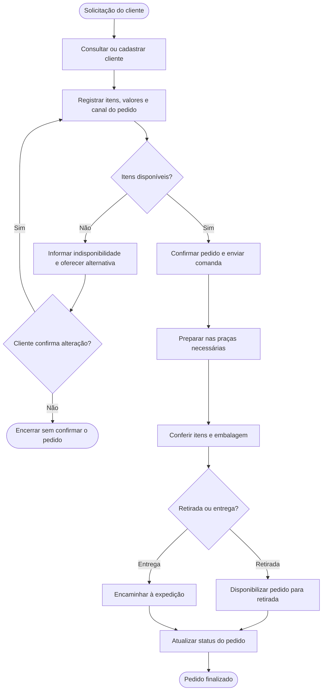
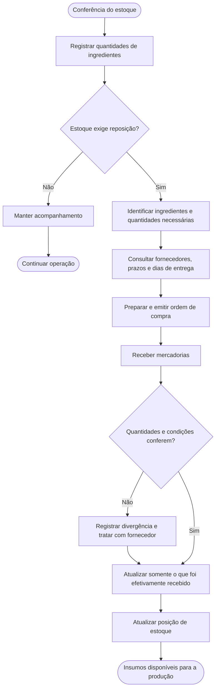
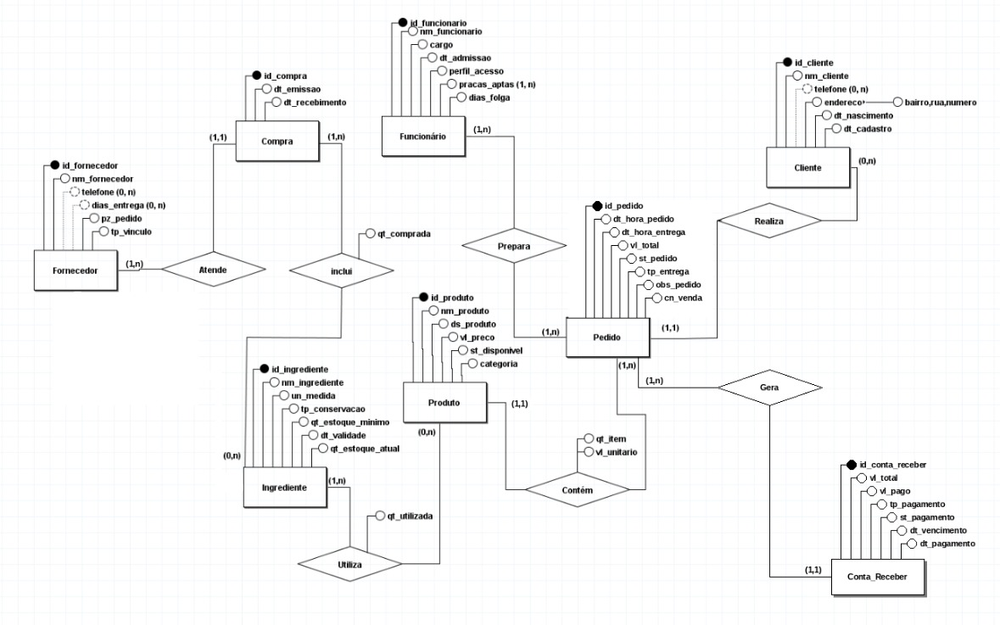

# Entrega 1 — Modelo Conceitual (DER)
### Modelagem de um sistema de gestão de informações para uma organização de pequeno porte

---

## Metadados

- **Nomes dos alunos e RGM**
  Murilo Silva de Jesus - 47940921
  Vinicius Ferreira Shinohara - 48101290
  Ítalo Augusto Gomes Azarias - 48262668
  Matheus Camargos Xavier da Costa - 47996544
  Marcos Vinicius Oliveira de Almeida - 47866381

## 1. Caracterização da Organização
*(vale 7,5% — Dimensão Conceitual)*

- **Nome e natureza da organização:** A organização escolhida foi uma Hamburgueria chamada Vaca Na Faca, cujo o dono é o Henrique
- **Contexto e porte:** É uma hamburguria com fins lucrativos, está em operação desde 2019, conta com 10/14 funcionários, com um volume aproximado de 100 pedidos por dia envolvendo Ifood, 99 e Keeta. O WhatsApp funciona apenas como canal de captação.
- **Problemas e necessidades identificados:** 
  1. Não há como identificar o responsável quando um pedido sai errado.
  2. Não existe medição de tarefas/missões da equipe
  3. Não há acompanhamentos da curva de aprendizado.
  4. Mesmo a organização ja tendo um sistema próprio, o checklist de estoque é feito manualmente no domingo a noite por conta de hábito operacional.
- **Justificativa da escolha:** A organização foi escolhida por fácil acesso por conta do dono ser primo de um dos integrantes.
- **Evidências da organização:** 
  Endereço: Rua Pedro Meira, 560 - Vila Curuçá, São Paulo - SP, 08030-500
  Contato (Instagram da Loja): @vacanafacaburguerhouse

---

## 2. Processos de Negócio
A hamburgueria Vaca na Faca executa atividades interligadas de atendimento, vendas, produção, controle de estoque, compras e organização da equipe. A descrição a seguir explicita entradas, responsáveis, etapas, saídas e integrações desses processos, considerando as informações levantadas na pesquisa sobre o estabelecimento. Quando uma etapa representa uma melhoria proposta para o sistema — e não uma rotina confirmada pela entrevista — isso é indicado no texto.
2.1 Atendimento e cadastro de clientes
Objetivo: identificar o cliente associado ao pedido e manter informações necessárias ao atendimento.
- Entrada: contato ou solicitação de compra de um cliente, pelos canais utilizados pela hamburgueria.
- Responsáveis: equipe de atendimento e sistemas dos canais de venda.
- Etapas: (1) receber a solicitação; (2) consultar se o cliente já possui cadastro; (3) quando necessário, registrar ou atualizar nome, contato e dados de entrega; (4) associar o cadastro ao pedido correspondente.
- Saída: informações do cliente disponíveis para consulta e para o registro da venda.
- Integração: fornece os dados utilizados no registro do pedido (2.2). O cliente pode estar cadastrado antes de realizar a primeira compra.
2.2 Registro e confirmação de pedidos (vendas)
Objetivo: transformar a escolha do cliente em um pedido identificável e encaminhá-lo à produção.
- Entrada: itens escolhidos, quantidades, canal de origem, informações do cliente e modalidade de retirada ou entrega.
- Responsáveis: equipe de atendimento e/ou plataforma de venda.
- Etapas: (1) receber o pedido, inclusive dos canais próprios e marketplaces; (2) identificar o cliente e os produtos solicitados; (3) registrar quantidades e valores praticados na venda; (4) verificar a disponibilidade dos itens; (5) confirmar o pedido ou informar a indisponibilidade e oferecer uma alternativa; (6) encaminhar a comanda à produção.
- Saída: pedido com identificador, itens, quantidades, preço e status, pronto para preparação.
- Integração: utiliza dados do cadastro de clientes (2.1) e do cardápio; depende da disponibilidade acompanhada pelo estoque (2.4); aciona a produção (2.3). O registro do pagamento e de repasses por marketplace, quando aplicável, permite a conferência financeira. A forma exata de conciliação precisa ser validada com a empresa.
2.3 Preparação, conferência e despacho dos pedidos
Objetivo: produzir os itens solicitados e encaminhar corretamente o pedido para retirada ou entrega.
- Entrada: comanda confirmada, produtos pedidos e respectivas fichas técnicas.
- Responsáveis: funcionários das praças de produção e equipe de expedição.
- Etapas: (1) receber a comanda; (2) distribuir as tarefas entre as praças necessárias, como chapa, fritadeira e montagem; (3) preparar os produtos conforme os itens solicitados; (4) conferir quantidades e composição; (5) embalar e encaminhar para retirada ou entrega; (6) atualizar o status do pedido.
- Saída: pedido concluído e encaminhado ao cliente, com status atualizado.
- Integração: recebe as informações de vendas (2.2), utiliza ingredientes controlados pelo estoque (2.4) e pode associar os funcionários participantes por meio da organização da equipe (2.6). O vínculo entre funcionário e pedido é especialmente relevante para investigar falhas e melhorar os processos. O registro individual dessa participação é uma melhoria proposta para o sistema.
2.4 Controle de estoque e disponibilidade de insumos
Objetivo: acompanhar os ingredientes disponíveis e evitar falta de materiais necessários à produção.
- Entrada: relação de ingredientes, quantidades existentes, consumo nas preparações e contagem física do estoque.
- Responsáveis: equipe ou responsável pelo estoque.
- Etapas: (1) realizar a conferência física dos itens — o levantamento identificou um checklist manual aos domingos; (2) registrar ou atualizar as quantidades disponíveis; (3) comparar as quantidades com os níveis mínimos definidos; (4) identificar insumos próximos da necessidade de reposição; (5) sinalizar a necessidade de compra; (6) atualizar a disponibilidade dos produtos afetados pela falta de ingredientes.
- Saída: posição atual do estoque, alertas de reposição e informações sobre disponibilidade de produtos.
- Integração: apoia a confirmação dos pedidos (2.2) e a produção (2.3); quando há necessidade de reposição, fornece informações ao processo de compras (2.5). A atualização automática do estoque a partir de cada receita é uma funcionalidade proposta, dependente de fichas técnicas confiáveis.
2.5 Compras e recebimento de mercadorias
Objetivo: repor ingredientes e registrar a entrada de materiais adquiridos dos fornecedores.
- Entrada: necessidades de reposição apontadas pelo estoque, ingredientes e quantidades desejadas, dados dos fornecedores e condições de fornecimento.
- Responsáveis: responsável pelas compras e funcionário encarregado do recebimento.
- Etapas: (1) consultar os insumos que precisam ser repostos; (2) verificar fornecedores aptos, disponibilidade, dias de entrega e antecedência exigida; (3) definir as quantidades considerando o consumo e a capacidade de armazenamento; (4) emitir a solicitação ou ordem de compra; (5) receber e conferir os produtos entregues; (6) registrar as quantidades recebidas e atualizar o estoque; (7) comunicar eventuais divergências.
- Saída: ordem de compra registrada e estoque atualizado após o recebimento.
- Integração: parte dos apontamentos do controle de estoque (2.4) e retorna a ele com os insumos recebidos, permitindo a continuidade das vendas (2.2) e da produção (2.3). A conferência detalhada de lotes e divergências é uma prática proposta para validação com o estabelecimento.
2.6 Organização da equipe e acompanhamento das atividades
Objetivo: organizar as responsabilidades dos colaboradores e melhorar a identificação de participantes no atendimento e na produção.
- Entrada: cadastro de funcionários, cargos, praças de atuação, escalas e registros de participação nas atividades.
- Responsáveis: gestão do estabelecimento e líderes operacionais.
- Etapas: (1) manter os dados básicos dos colaboradores; (2) identificar funções e praças nas quais cada pessoa atua; (3) organizar a distribuição de tarefas conforme a escala; (4) associar os funcionários aos pedidos em que atuaram, quando esse registro estiver disponível; (5) consultar o histórico para analisar ocorrências e necessidades de treinamento.
- Saída: equipe organizada e possibilidade de rastrear a participação dos colaboradores nas atividades.
- Integração: dá suporte à produção e expedição (2.3) e ao atendimento (2.1–2.2). O histórico individual de participação e o acompanhamento de desempenho são melhorias propostas para resolver a dificuldade relatada de identificar responsáveis por erros.
2.7 Fluxograma de vendas, produção e entrega

Interpretação: o fluxo começa no atendimento, utiliza dados do cliente e da disponibilidade do estoque, passa pela produção e termina com retirada ou entrega. A confirmação do pedido cria os registros necessários para acompanhamento e eventual conferência financeira.
2.8 Fluxograma de estoque, compras e recebimento

Interpretação: a necessidade de compra é identificada pelo controle de estoque. A aquisição é direcionada aos fornecedores cadastrados, e o recebimento alimenta novamente o estoque, que sustenta a preparação dos pedidos.
2.9 Integração geral dos processos
Os seis processos compõem um ciclo de informações: atendimento e cadastro → registro da venda → produção e despacho. Ao mesmo tempo, produção → consumo de ingredientes → controle do estoque → compras e recebimento → reposição do estoque. A organização da equipe dá suporte ao atendimento e à produção e ajuda a identificar quem participou de cada etapa.

Dessa forma, os processos não são atividades isoladas: o pedido depende do cliente e dos produtos disponíveis; a produção depende do estoque e dos funcionários; e a reposição depende da identificação das necessidades e do relacionamento com fornecedores. Essa integração orienta os dados necessários para a modelagem conceitual apresentada nas demais seções do projeto, sem exigir modificações nelas.
Nota de validação: o checklist manual aos domingos e a dificuldade de rastrear a responsabilidade por pedidos foram relatados no levantamento. Outras etapas descritas aqui representam fluxos operacionais típicos e/ou propostas de melhoria; o grupo deve confirmar os detalhes com a hamburgueria antes de apresentá-los como rotinas já existentes.

## 3. Requisitos do Sistema
*(esta seção e a Seção 4 "Regras de Negócio" DIVIDEM 7,5% na dimensão conceitual — juntas valem 7,5%, não 7,5% cada — + 4% exclusivos desta seção na organização/documentação)*

### 3.1 Requisitos Funcionais
1. Cadastro e consulta de clientes com histórico de pedidos.
2. Gestão do cardápio (produtos, preços, categorias). 
3. Definição da ficha técnica de cada produto, indicando quais ingredientes ele utiliza. 
4. Registro de pedidos com canal de venda, modo de entrega, situação e observação do cliente.
5. Identificação de quais funcionários prepararam cada pedido.
6. Controle de estoque com data de validade e estoque mínimo.
7. Gestão de fornecedores com dias de entrega e prazo de pedido.
8. Consulta de quais produtos utilizam cada insumo, para retirar itens do cardápio quando um ingrediente falta.

### 3.2 Requisitos Não Funcionais
1. Segurança, apenas administradores podem cancelar pedidos.
2. Interface simples.
3. Suportar até 100 pedidos por dia.

---

## 4. Regras de Negócio
*(esta seção DIVIDE com a Seção 3 "Requisitos do Sistema" os mesmos 7,5% da dimensão conceitual — juntas valem 7,5%, não 7,5% cada — + 4% exclusivos desta seção na documentação. "Regras de negócio" é o termo técnico usado em modelagem de dados para as regras de funcionamento de qualquer organização, com ou sem fins lucrativos)*

- **Regras operacionais:** 
1. Estoque mínimo gera ordem de compra. Evita ruptura (produto indisponível e cancelamentos) e excesso de compra. O sistema precisa de estoque mínimo por insumo e gatilho automático.
2. Usar primeiro o insumo de validade mais curta (PVPS). Reduz desperdício e risco sanitário. O estoque deve registrar lote e validade.
3. Lanches montados conforme a ficha técnica. Garante padrão de qualidade, controle de custo e baixa automática de insumos a cada venda.
4. Fornecedores têm dias fixos de entrega e prazo de pedido. Define quando comprar para não faltar insumo. O cadastro guarda dia de entrega, prazo e lead time.
- **Restrições organizacionais:** 
1. Espaço físico limitado (congelados: máximo de 2 semanas). Limita o volume de compra e reforça o controle de validade. O sistema precisa de estoque máximo por categoria e alertas.
2. Dependência de 99 Food, iFood e Keeta. A loja não controla taxas, comissões e regras das plataformas, o que afeta a margem. O sistema deve centralizar os pedidos e considerar a comissão no cálculo.
3. LGPD. Dados do cliente são protegidos por lei (Lei 13.709/2018). O sistema precisa de controle de acesso, armazenamento seguro e exclusão sob solicitação.
---

## 5. Dicionário de Dados Conceitual (Preliminar)
*(vale 10% — Dimensão Procedimental - Segue o modelo do arquivo 02-03g_Exemplo_Dicionario_Dados.pdf)*

Para cada entidade identificada, liste:

| Atributo | Descrição | Regra de negócio associada |
|----------|-----------|------------------------------|
| *nome do atributo* | *o que ele representa* | *se houver alguma regra (obrigatoriedade, valores possíveis, etc.)* |

*Mantenha o dicionário organizado e padronizado (mesmo formato de tabela para todas as entidades).*

**Atenção à privacidade:** se forem usados exemplos de valores para ilustrar os atributos, esses exemplos devem ser **fictícios** — não utilize dados reais de clientes, fiéis, beneficiários, doadores ou funcionários da organização (nomes, CPFs, contatos etc.), mesmo que tenham sido observados durante a pesquisa de campo. Os exemplos devem apenas ser **coerentes com as operações reais** observadas.

---

## 6. Modelagem Conceitual (Entidades, Atributos, Relacionamentos)
*(vale 7,5% na dimensão conceitual)*

- **Entidades reconhecidas:**

| Entidade | Justificativa |
|---|---|
| Cliente | Quem realiza os pedidos, precisa ser identificado para histórico e entrega. |
| Pedido | Registro central da operação - cerca de 100 por dia, em quatro canais diferentes. |
| Produto | Itens do cardápio vendidos ao cliente. |
| Ingrediente | Insumos controlados em estoque, com validade e tipo de conservação. |
| Fornecedor | Origem dos insumos, com dias fixos de entrega e prazo de pedido. |
| Funcionário | Equipe de 10 a 14 pessoas, com cargos, praças e escala. |

- **Atributos e classificações:**
Cliente: id_cliente (identificador), nm_cliente, telefone (multivalorado), endereco (composto: bairro, rua, numero), dt_nascimento, dt_cadastro.

Pedido: id_pedido (identificador), dt_hora_pedido, vl_total, st_pedido, tp_entrega, obs_pedido, cn_venda.

Produto: id_produto (identificador), nm_produto, ds_produto, vl_preco, st_disponivel, categoria.

Ingrediente: id_ingrediente (identificador), nm_ingrediente, un_medida, tp_conservacao, qt_estoque_minimo, dt_validade.

Fornecedor: id_fornecedor (identificador), nm_fornecedor, telefone (multivalorado), dias_entrega (multivalorado), pz_pedido, tp_vinculo.

Funcionário: id_funcionario (identificador), nm_funcionario, cargo, dt_admissao, perfil_acesso, pracas_aptas (multivalorado), dias_folga.

**Relacionamentos pertinentes:**

| Relacionamento | Cardinalidade | Atributo próprio |
|---|---|---|
| Cliente **Realiza** Pedido | (0,n) - (1,n) | - |
| Funcionário **Prepara** Pedido | (0,n) - (1,n) | - |
| Pedido **Contém** Produto | (1,n) - (1,n) | - |
| Produto **Utiliza** Ingrediente | (0,n) - (1,n) | - |
| Fornecedor **Fornece** Ingrediente | (0,n) - (0,n) | - |

- **Restrições e políticas organizacionais aplicadas ao modelo.**
1. qt_estoque_minimo no Ingrediente sustenta a regra de abertura de ordem de compra quando o insumo atinge o mínimo.
2. dt_validade e tp_conservacao sustentam a regra de uso por validade mais curta (FIFO) e o limite de duas semanas para congelados.
3. perfil_acesso no Funcionário sustenta a política de que apenas o administrador pode cancelar, estornar e alterar dados fiscais.
4. dias_folga e pracas_aptas refletem a escala 6x1 e a distribuição da equipe entre as quatro praças
cn_venda no Pedido registra o canal de origem (site próprio, iFood, Keeta, 99Food).
5. Endereco decomposto em bairro, rua e número permite consultas por região para a operação de delivery.

---

## 7. Diagrama Entidade-Relacionamento (DER)
*(vale 20% — é o item de maior peso da entrega)*

---

## 8. Justificativa Técnica
*(vale 7,5% — sozinho, é o subcritério de maior peso dentro da Dimensão Conceitual)*

As entidades do modelo(Funcionário, fornecedor, ingrediente, produto, pedido e cliente) representam os objetos centrais da operação e fazem parte do critério de existência independente, todos identificamos na entrevista. Os relacionamentos seguem a lógica real do negócio: 

Tópico 1: Cardinalidade e Mapeamento mais detalhado.

​1. Cliente(0,n) - (1,1)Pedido (Relacionamento Realiza);

​Decisão Adotada: Cardinalidade (0,n) em Cliente e (1,1) em Pedido;

​Observação: Permite o registro de leads(interesse do cliente para com um determinado produto) e prospecções(atendimento a potenciais clientes que entram em contacto sem concluir o pedido). Por outro lado, a participação total (1,1) do Pedido impede vendas "órfãs", garantindo que todo o registro financeiro/fiscal esteja atrelado a um titular específico;

​Alternativa Descartada: Exigir (1,n) em Cliente (obrigatoriedade de compra no cadastro) eliminaria a funcionalidade de CRM e base de dados para captação de novos clientes.

​2. Pedido(1,n) - (1,1)Produto (Relacionamento Contém);

​Decisão Adotada: Cardinalidade (1,n) em Pedido e (1,1) na perspetiva da instância/item do produto associado;

​Observação: Garante a restrição operacional de que nenhum pedido possa ser gerado vazio ou sem itens. A nível do item comercializado, vincula-se com precisão a uma entrada única do catálogo para o correto abate do valor unitário e de stock;

​Atributos de Ligação: Foram alocados diretamente na associação/item os atributos (qt_item) e (vl_unitario) para preservar o histórico do preço praticado no momento exato da venda.

​3. Pedido(1,n) - (1,1)Conta_Receber (Relacionamento Gera); 

​Decisão Adotada: Cardinalidade (1,n) em Pedido e (1,1) em Conta_Receber;

​Observação: Permite a consolidação financeira de múltiplos pedidos em um único título de cobrança (ex.: faturamento quinzenal/mensal para clientes corporativos ou comandas abertas). Adicionalmente, garante que cada pedido pertença obrigatoriamente a uma cobrança rastreável;
  
​Alternativa Descartada: Um relacionamento 1:1 estrito impediria o faturamento agrupado por lote de pedidos do mesmo cliente.

​4. Funcionário(1,n) - (1,n)Pedido (Relacionamento Prepara);

​Decisão Adotada: Cardinalidade N:N (1,n para 1,n);
  
​Justificativa Técnica: Um pedido pode envolver múltiplos colaboradores em diferentes etapas (atendimento, montagem, embalagem). Do mesmo modo, um funcionário atende a múltiplos pedidos ao longo do seu turno. Isso assegura métricas de produtividade e auditoria de qualidade na produção;

​5. Produto(1,1) - (1,n)Ingrediente (Relacionamento Utiliza);

​Decisão Adotada: Ficha técnica automatizada. Um produto utiliza 1 ou mais ingredientes, e o ingrediente pode estar presente em vários produtos;
 
​Atributo de Ligação: Contém a (qt_utilizada), essencial para calcular o Custo de Mercadoria Vendida (CMV) e efetuar o abate automático dos insumos do stock no ato da venda. 

Tópico 2: Decisão de Entidades.

Decisão Adotada: (Entidade Transacional Compra):
​Fornecedor (0,n) <Atende> (1,1) Compra  
​Compra (1,n) <Inclui> (0,n) Ingrediente (com o atributo qt_comprada).
  
​Por que importa: Permite registrar o histórico de entradas e aquisições ao longo do tempo (armazenando dt_emissao e dt_recebimento). Sem a entidade Compra, seria impossível saber quando, quanto e por qual valor determinado insumo foi realocado no lote de stock.
 
​O Papel do Relacionamento Fornece (N:N Direto):
​A relação direta Fornecedor (0,n) <Fornece> (0,n) Ingrediente foi mantida no modelo como uma tabela de homologação/catálogo. Ela detalha especificamente quais matérias-primas cada fornecedor está apto a vender, servindo para a cotação prévia de preços e substituição rápida de parceiros em caso de ruptura de stock.

Tópico 3: Atributos multivalorados e Derivações

- ​dias_entrega (em Fornecedor): Representado como (0,n), pois um fornecedor pode efetuar entregas em múltiplos dias da semana.  
​pracas_aptas (em Funcionário): Representado como (1,n), indicando que um colaborador pode operar em uma ou mais estações de trabalho/praças de cozinha.  
- ​telefone (em Fornecedor e Cliente): Indicado com (0,n), suportando múltiplos contactos telefônicos por registro.  
​Justificativa de Design: No modelo lógico/relacional, estas propriedades serão desmembradas em tabelas auxiliares/de junção, prevenindo a violação de atributos atômicos (primeira forma normal).

​Endereço Estruturado (Cliente):
​O atributo endereco desdobra-se em bairro, rua e numero, viabilizando rotas de entrega regionalizadas e consultas analíticas por zona geográfica.
---

## 9. Uso de Inteligência Artificial
*(documentação obrigatória — não é opcional se o grupo usou IA em qualquer etapa: pesquisa, escrita, organização de ideias ou revisão de texto)*

Se o grupo usou alguma ferramenta de IA (ChatGPT, Claude, Gemini, Perplexity etc.) em qualquer parte do trabalho, registre **para cada uso relevante**:

| Item | Registro |
|---|---|
| **Ferramenta e etapa** | Claude, na preparação da entrevista de campo com o dono da hamburgueria |
| **Motivação** | Extrair o máximo de informação relevante de um dono não-técnico, sem desperdiçar a visita |
| **Prompt utilizado** | "escolhemos uma hamburgueria, porém ela já possui um CRM (...) gostaria de desenvolver as perguntas que devem ser feitas com o dono da hamburgueria para que possamos extrair o máximo de informações relevantes" |
| **Resposta recebida** | Roteiro organizado em 8 blocos temáticos (contexto geral, CRM existente, estoque, cardápio/produção, pedidos, funcionários, dores, fechamento/evidências), com perguntas abertas antes das específicas |
| **Fontes consultadas** |Não houve. |
| **Trechos rejeitados/corrigidos** | Nenhuma pergunta foi descartada; o roteiro foi aplicado quase integralmente na entrevista real |
| **Justificativa final** | O roteiro cobria exatamente as seções do README (caracterização, processos, requisitos, regras), então foi mantido |
| **Reflexão crítica** | As perguntas eram genéricas de "hamburgueria"; especificidades reais do negócio (ficha técnica, quatro praças de produção) só surgiram nas respostas do Henrique, não foram antecipadas pela IA |
| Item | Registro |
|---|---|
| **Ferramenta e etapa** | Claude, na revisão técnica do dicionário de dados já elaborado pelo grupo |
| **Motivação** | Confirmar se o dicionário seguia a notação e estrutura ensinadas nas aulas antes da entrega |
| **Prompt utilizado** | "esse HTML é o nosso dicionário de dados, analise com cuidado e de acordo com os documentos enviados ele está correto? encaminhei também a foto do DER" |
| **Resposta recebida** | Apontamento de falta de estrutura (notação formal por entidade, seção de convenções e LGPD), prefixos fora do padrão da disciplina, erros de tipo de dado, coluna de restrição misturando conceitos, descrições circulares e ausência de chaves estrangeiras |
| **Fontes consultadas** | PDFs da disciplina (Construção de Dicionário de Dados e exemplo de referência) e a imagem do DER, usados para checar cada apontamento antes de sugerir |
| **Trechos rejeitados/corrigidos** | Correções ainda em aplicação pelo grupo; nenhuma sugestão foi aceita sem conferência |
| **Justificativa final** | IA usada como camada de revisão e apontamento de erros, não como autora final — o dicionário corrigido ainda passa por conferência do grupo antes de ser aceito |
| **Reflexão crítica** | A IA identificou problemas reais de notação, mas as sugestões de correção de cardinalidade no DER dependiam de leitura visual da imagem e exigiram confirmação humana |

*Se o grupo não usou nenhuma ferramenta de IA, declare isso explicitamente nesta seção.*

---

## Critérios Atitudinais (20%)
**Estes critérios NÃO constam explicitamente como item de entrega no README.** Eles são avaliados por meio de **Avaliação 360º entre os integrantes do grupo** (cada membro avalia os colegas de equipe) e, no caso da Colaboração, também pela **colaboração equilibrada no histórico de commits** do repositório GitHub — não pela leitura do restante do repositório nem pela apresentação:

- **Participação (5%):** envolvimento nas discussões técnicas e nas decisões do grupo.
- **Comprometimento (5%):** cumprimento de prazos e responsabilidades assumidas.
- **Colaboração (5%):** respeito às contribuições dos colegas, cooperação na construção do projeto e colaboração equilibrada no histórico de commits do repositório GitHub.
- **Autonomia (5%):** busca independente de soluções e proposta de melhorias.

---

## Resumo dos Pesos

| Dimensão | Peso total |
|----------|-----------|
| Conceitual (contexto, requisitos/regras, modelagem, justificativa técnica) | 30% |
| Procedimental (requisitos, fluxogramas, dicionário de dados, DER) | 50% |
| Atitudinal (participação, comprometimento, colaboração, autonomia) | 20% |

**Entrega final:** README.md completo + DER + Dicionário de Dados em HTML (com exceção dos cursos GTI) anexado no repositório GitHub do grupo.
